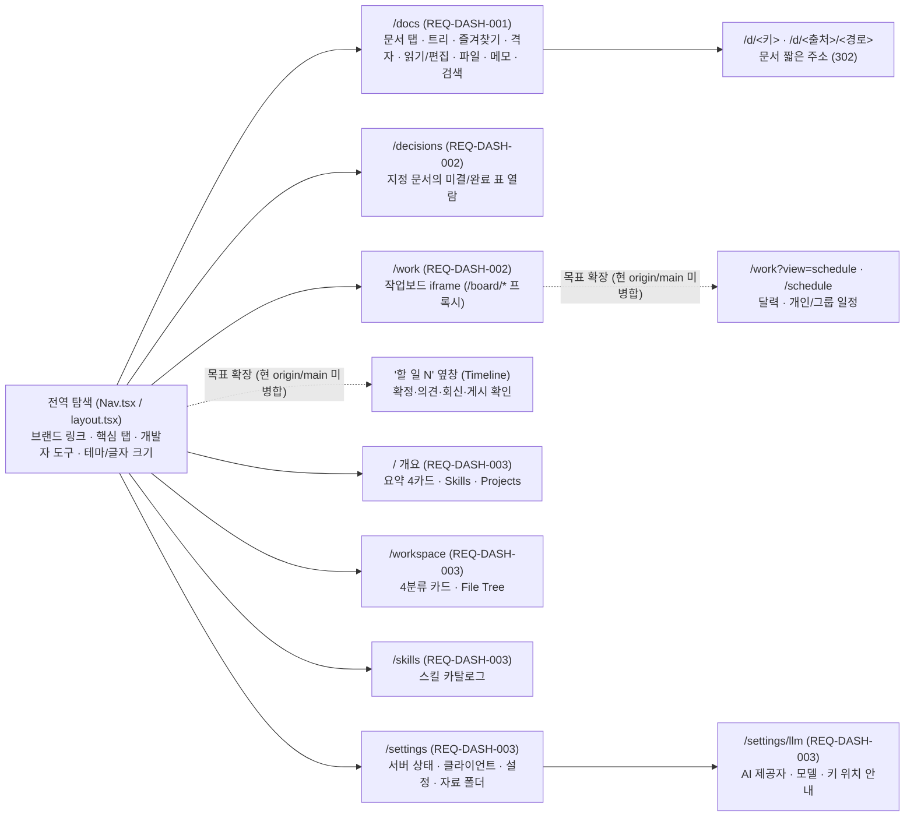

이 문서가 답하는 질문: Naia ADK 대시보드는 무엇을 위해 존재하며, 각 화면과 API·파일 원천, 요구사항·시험 사슬은 어떻게 연결되는가?
상태: 현행 기준 (`origin/main` 실물 근거 + 미병합·미연결 빈칸 구분)
기준판: 공개 저장소 `ed104d328ff7870908d326df840e4b98a1718a03`

# Naia ADK 대시보드 · 하네스 거버넌스 상위 기획 및 사슬 지도

이 문서는 `packages/dashboard`(Next.js BFF `:3142`)와 `packages/server`(Fastify API `:3141`), 그리고 대시보드·업무 장부 운영의 전제가 되는 하네스 거버넌스 규율의 **상위 기획(`PC`)**, **화면 지도(`SP`)**, **원천(API·파일) 표**, **요구·시험 추적 사슬**을 정의한다.

> 관련 요구사항:
> - [REQ-DASH-001 (문서·짧은 주소·메모·접속 검사)](../../.agents/requirements/REQ-DASH-001.yaml)
> - [REQ-DASH-002 (작업·장부·일정·할 일·결정)](../../.agents/requirements/REQ-DASH-002.yaml)
> - [REQ-DASH-003 (개요·스킬·설정·작업 공간)](../../.agents/requirements/REQ-DASH-003.yaml)
> - [REQ-GOV-001 (층 분리·리뷰 상한·계획 쓰기 잠금)](../../.agents/requirements/REQ-GOV-001.yaml)
> - [REQ-WAKE-001 (깨움·응답 감시·장부)](../../.agents/requirements/REQ-WAKE-001.yaml)

---

## 1. 목적 — 사용자가 무엇을 하려고 쓰는가

1. **비개발자·개발자 공용 웹 포털**: 사람이 터미널·Git·YAML 원문을 직접 열지 않고도 브라우저(PC·테일넷 모바일)에서 워크스페이스 문서·파일·결정·작업 현황·일정·스킬·설정을 한 곳에서 보고 다룰 수 있게 한다.
2. **문서 중심 AI 협업 루프**: 단순 열람을 넘어 브라우저에서 마크다운 문서를 편집·저장(ETag 충돌 방지)하고, 문장에 인용 메모를 남겨 AI에게 처리를 맡기며, 짧은 주소(`/d/<키>`)로 메신저·승인 카드에 연결한다.
3. **계층형 접근 경계**: `naia-adk` 공개 기본판과 조직·회사 포크(`data-company/*/adk-company.json`)를 구분하고, `hostGuard`·`evaluateTrust`(프록시 비밀 + loopback/tailnet 검증)·`Origin` 검증·경로 탈출/하드링크 차단을 통해 로컬·테일넷 밖 노출과 데이터 유출을 막는다.
4. **거버넌스 결합**: 대시보드·업무 장부·계획 리뷰가 어긋나지 않도록 3층(조율)의 저장소 직접 쓰기 차단, 코드 검수 2회 FAIL 상한, 계획 리뷰 중 저장소 쓰기 잠금을 함께 추적한다.

---

## 2. 화면 지도 (Screen Map)



| 경로 / UI 영역 | 역할 (사용자 목적) | 요구 ID | `origin/main` (`ed104d32`) 구현 상태 |
|---|---|---|---|
| 전역 탐색 막대 (`Nav.tsx`, `layout.tsx`) | 브랜드 링크(`/docs` 이동), 핵심 탭(`문서`·`결정`·`작업`), 개발자 도구 링크, 테마(라이트/다크/시스템)·글자 크기(4단계) 전환 | `REQ-DASH-001` / `002` / `003` | 구현됨 (`'⋯'` 더보기 드롭다운·`일정` 탭·`'할 일 N'` 옆창·`'또렷하게'` 토글·인스턴스 브랜드명 설정은 미병합/미연결) |
| `/docs` 문서 화면 | 탭 분리, 트리 탐색, 즐겨찾기, 폴더 격자, 문서 읽기/편집(ETag), 파일 보기(이미지/영상/오디오/PDF/텍스트), 인용 메모, 검색(`archived=1`) | `REQ-DASH-001` | 구현됨 (`사업` 탭·데스크톱 접기·목차/목록/썸네일 전환·다중선택 zip·`RichDocEditor`·`PublishReview`·`Mermaid` 확대 뷰어는 미병합/미구현) |
| `/d/<키>` · `/d/<출처>/<경로>` | 짧은 주소 발급(`POST /d`) 및 긴 문서 주소 302 리다이렉트, CLI(`short-link.mjs`) | `REQ-DASH-001` | 구현됨 |
| `/decisions` 결정 목록 | `localStorage`에 설정한 문서의 대기/완료 마크다운 표 파싱 및 원문 이동 | `REQ-DASH-002` | 구현됨 (읽기·링크 이동 전용; 인라인 `[확정]`/`[반려]` 및 서버 저장 API 미구현) |
| `/work` · `/board/[[...path]]` | `adk-company.json`의 `board.port` 작업보드를 `/board/index.html` iframe으로 프록시 | `REQ-DASH-002` | 구현됨 (`scripts/work-ledger/*` 및 `scripts/work-now-board.mjs`와 자동 연결되지 않음) |
| `/work?view=schedule` · `/schedule` | 월/주 일정 달력, 4개 레이어 토글, 개인 일정 YAML CRUD | `REQ-DASH-002` | **미병합** (`origin/main`에 `ScheduleView`·`/board-schedule`·`/schedule-personal` 없음; 문서 머리말 검사기 `adk-schedule.mjs`만 존재) |
| 전역 `'할 일 N'` 옆창 (`Timeline`) | 확정·의견·회신·게시 확인 통합 대기열 | `REQ-DASH-002` | **미병합** (`origin/main`에 `TimelinePanel`·`/board-waits` 없음) |
| `/` 개요 | 워크스페이스 이름, 요약 4카드(`Projects`, `Submodules`, `References`, `Skills`), 스킬·프로젝트 요약 목록 | `REQ-DASH-003` | 구현됨 (영문 라벨·정적 카드, 한국어화·인스턴스 브랜드 설정 미적용) |
| `/workspace` 작업 공간 | `Projects`·`Data`·`Libraries`·`References` 4분류 카드 및 루트 `File Tree` JSON 표시 | `REQ-DASH-003` | 구현됨 (정적 `<div>` 카드·영문 UI) |
| `/skills` 스킬 카탈로그 | `skills/*/SKILL.md` 목록·설명·트리거·관리 구분 열람 | `REQ-DASH-003` | 구현됨 (정적 카드·상세/한국어 요약 미구현) |
| `/settings` · `/settings/llm` | API 서버 연결 상태, 클라이언트 목록(정적), 설정 파일 목록, 데이터 폴더, AI 제공자/모델/키 위치 안내 | `REQ-DASH-003` | 구현됨 (`UsagePanel` 미병합; 클라이언트 연결 검사·실서버 LLM 조회·`/settings` 복귀 링크 미구현) |

---

## 3. 원천 (API · 파일) 표

| 화면 / 기능 | BFF · API 경로 (코드 위치) | 파일 · 저장소 원천 | 요구 ID |
|---|---|---|---|
| Host·접속·프록시 보호 | `middleware.ts`, `server.mjs` (`createRequestHandler`, `validatePortalPathname`, `proxyToApi`), `packages/server/src/server.ts` (`onRequest`) | `NAIA_DASHBOARD_HOSTS`, `tailscale status --json`, `$XDG_RUNTIME_DIR/naia-adk/portal-proxy-secret-<port>` (또는 `os.tmpdir()/naia-adk-<uid>/`), `x-naia-peer`/`x-naia-local`/`x-naia-origin-ok` | `REQ-DASH-001` |
| 문서 포털 목록 · 검색 | `GET /api/portal`, `GET /api/portal/workspace`, `GET /api/portal/search` (`packages/server/src/routes/portal.ts`) | `docs/`, `data-company/*/adk-company.json`, `.agents/view-folders.json`, `packages/server/src/view-folders.ts` | `REQ-DASH-001` |
| 문서 읽기·저장·폴더·파일 | `GET /api/portal/doc`, `PUT /api/portal/doc`, `GET /api/portal/folder`, `GET /api/portal/asset`, `GET /api/portal/text` (`portal.ts`) | 각 출처 루트(`docs/`, 회사·레포 `docs.include`, `data:` 출처 `readOnly`), `withFileLock` | `REQ-DASH-001` |
| 인용 메모 · 즐겨찾기 | `GET/POST /api/portal/notes`, `GET /api/portal/notes/counts`, `PATCH/DELETE /api/portal/notes/:id`, `GET/POST/DELETE /api/portal/favorites` (`portal.ts`) | `.agents/notes/<id>.json` (`notes.ts`, `scripts/doc-notes.mjs`), `.agents/favorites.json` (`favorites.ts`), `withFileLock` | `REQ-DASH-001` |
| 문서 짧은 주소 | `POST /d`, `GET /d/<키>`, `GET /d/<출처>/<경로>` (`packages/dashboard/server.mjs` `handleShortLink`, `short-links.mjs`) | `NAIA_SHORT_LINKS_FILE` (기본 `packages/dashboard/data/short-links.json`), `config/short-link.example.json`, `scripts/short-link.mjs` | `REQ-DASH-001` |
| 작업보드 프록시 | `GET/HEAD/POST /board/[[...path]]` (`packages/dashboard/app/board/[[...path]]/route.ts`), `GET /api/portal` (`board.port`) | `data-company/*/adk-company.json` (`board.repo`, `board.script`, `board.port`, `board.queueRepo`), `scripts/adk-board.mjs` | `REQ-DASH-002` |
| 업무 장부 · 현재 업무 판 · 일정 검사 | CLI·로컬 인증 서버 `GET /`, `GET /api/work` (`scripts/work-now-board.mjs`); `scripts/work-ledger/{ledger,drive,ledger-watch,due-timer}.mjs` | 역할별 장부 JSON/YAML(`.agents/work/ledger/<role>.json` 또는 `--ledger`), 작업 문서 머리말 `마일스톤:`/`기한:` (`scripts/lib/adk-schedule.mjs`) | `REQ-DASH-002` |
| 결정 목록 | `GET /api/portal/text?source=…&path=…` (`app/decisions/page.tsx`, `DecisionList.tsx`, `decisions.ts`) | 브라우저 `localStorage["naia.decision-document.v1"]` + 지정 마크다운 문서의 대기/완료 표 | `REQ-DASH-002` |
| 테마 · 글자 크기 설정 | 클라이언트 전용 (`app/theme-prefs.ts`, `layout.tsx`, `Nav.tsx`) | 브라우저 `localStorage["naia-adk-theme"]`, `localStorage["naia-adk-font-size"]` | `REQ-DASH-001` |
| 개요 · 작업 공간 | `GET /api/workspace/meta`, `GET /api/workspace/index`, `GET /api/workspace/tree` (`packages/server/src/routes/workspace.ts`) | `.agents/context/project-index.yaml`, 저장소 파일 트리 (`packages/core/src/index.ts`) | `REQ-DASH-003` |
| 스킬 카탈로그 | `GET /api/skills`, `GET /api/skills/:name`, `GET /api/skills/:name/content` (`packages/server/src/routes/skills.ts`) | `skills/*/SKILL.md` (`discoverSkills`) | `REQ-DASH-003` |
| 설정 · 연결 상태 · 파일 감시 | `GET /api/health` (`server.ts`), `WS /api/ws/*` (`routes/watch.ts`) | `.agents/context/*`, `AGENTS.md`, `.gitignore`, `.gitmodules`, `README.md`, `.agents/context/llm-config.yaml`(안내), `data-private/.env`(안내) | `REQ-DASH-003` |

---

## 4. 하네스 거버넌스 경계 연계 (`REQ-GOV-001`)

대시보드와 업무 장부·계획 문서가 신뢰성을 유지하려면 다음 세 가지 하네스 규율이 코드·훅으로 함께 동작해야 한다.

| 규율 | 목적 | 기준 구현 | 설계·안내 문서 |
|---|---|---|---|
| **층 분리 쓰기 막기** | 3층(조율 세션)은 감시·평가·소통만 수행하고 저장소 코드는 2층 일꾼에게 지시서로 위임 | `.claude/hooks/lead-write-guard.js`, `.claude/hooks/lib/lead-guard.js`, `scripts/lead-guard-exception.mjs`, `.agents/hooks/muse-pretooluse-adapter.cjs` | [lead-write-guard.md](../guides/lead-write-guard.md) |
| **코드 검수 회차 상한** | 동일 `review-lane`에서 코드 검수 `판정: FAIL` 2회 도달 시 다음 `fix` 회차를 차단(exit 3)하고 `review-cap-reset:` 요구 | `scripts/worker-runner/review-cap.mjs`, `scripts/worker-runner/cli.mjs`, `scripts/worker-runner/spawn-worker.mjs` | [worker-runner README](../../scripts/worker-runner/README.md) |
| **계획 리뷰 중 쓰기 잠금** | `approval-plan.mjs review` 실행 중 대상 저장소의 `.agents/state/plan-review.lock` 을 감시해 파일·셸 쓰기를 fail-closed 차단 | `.claude/hooks/plan-review-write-guard.js`, `.claude/hooks/lib/deploy-plan.js`, `.claude/hooks/lib/plan-review-write-targets.js`, `.agents/scripts/approval-plan.mjs` | [plan-review-write-guard.md](../guides/plan-review-write-guard.md), [approval-plan-gate.md](../guides/approval-plan-gate.md) |

---

## 5. 사슬 검증 및 알려진 빈칸

1. **추적성 검증**: `.agents/requirements/_index.yaml`에 등록된 모든 `REQ-*.yaml`의 `trace.code`, `trace.tests`(`"없음"` 표기 제외), `trace.documents` 파일 실존 여부와 문서 상대 링크 무결성은 아래 명령으로 검증한다.
   ```sh
   pnpm test:spec-chain
   ```
2. **하위 프로젝트 뼈대 검증**: `adk-scaffold-project.mjs`로 생성한 `project` ADK의 `00..08` 사슬 검증은 [validate-spec-chain.mjs](../../templates/project-skeleton/scripts/validate-spec-chain.mjs)와 `pnpm test:adk-v020`이 담당한다.
3. **현재 남은 시험·구현 빈칸 (다음 작업 목록)**:
   - `REQ-DASH-001`: `app/docs/page.tsx` App Router 통합 시험, `RichDocEditor`·`PublishReview`·다중선택 zip·`사업` 탭·`Mermaid` 확대 뷰어 구현/시험, `workspace-docs-it`/`e2e`의 `pnpm test` 편입.
   - `REQ-DASH-002`: `app/work/page.tsx` & `/board/[[...path]]` 프록시 시험, `app/decisions/page.tsx` 상태/저장 시험 및 인라인 확정/반려, `ScheduleView`·`TimelinePanel`의 `origin/main` 통합 및 E2E, `work-ledger`↔`/work` 연결.
   - `REQ-DASH-003`: `/`, `/workspace`, `/skills`, `/settings`, `/settings/llm` 프론트 렌더/E2E 시험 0건 해소 및 `/api/workspace/*`, `/api/skills/*`, `/api/ws/*` 서버 라우트 단위/통합 시험 추가, `UsagePanel` 통합 및 정적 카드 링크/한국어화.
   - `REQ-GOV-001`: `agy`/`codex` 비Claude/비Muse 3층 세션용 `lead-write-guard`·`plan-review-write-guard` 어댑터 및 운영 체크아웃 핀 일치 점검 시험.
