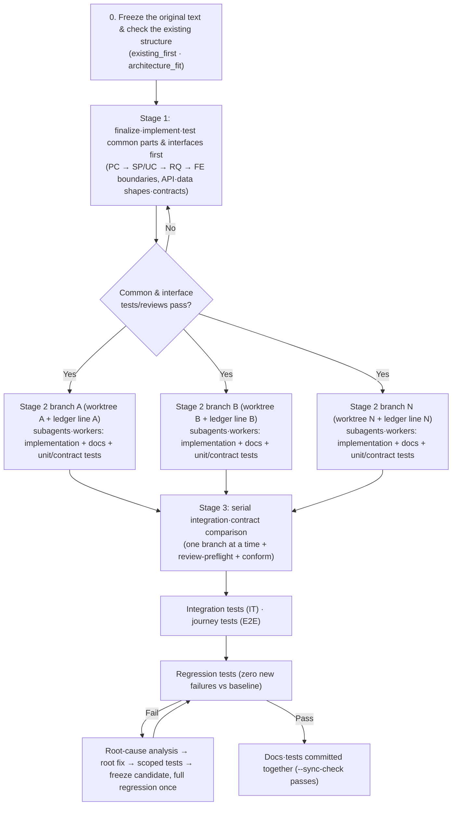

[English](development-method.en.md) | [한국어](development-method.md)

Question this document answers: in Naia ADK, in what order do we develop
services/features, and how do we keep documentation, testing, and regression
verification tied together?
Status: current baseline
Baseline: public repository `ed104d328ff7870908d326df840e4b98a1718a03`
Scope: common

# Naia ADK development method — common/interfaces first, parallel development, integration/regression

This document defines the **single canonical development order** Naia ADK
follows when designing, implementing, verifying, and integrating services
and features, plus the discipline of updating docs and tests together.

## Background

Owner's directives of 2026-11-18, quoted verbatim:

- `05:25Z`: "develop common parts and interfaces first so that everything can be developed in parallel"
- `05:29~05:30Z`: "every service and feature must support documentation, testing, and regression testing", "from top-level planning down to integration tests", "when a feature changes, the corresponding parts must change too"
- `05:32Z`: "use subagents aggressively to develop fast in parallel"
- `05:33Z`: "for parallel development, develop common parts and interfaces first, then parallel concurrent development, then integration", "put this in an explicit development-method statement too"

The existing workflows (`.agents/workflows/issue-driven-development.yaml`,
`.agents/context/agents-rules.json`) and the harness book (`hb-20261112`
`bd8b50a`) already held contract-first (ch. 7), spec-chain traceability (chs.
9–10), bottom-up integration with selective regression (ch. 12), role
separation (ch. 15), and parallel worktrees with serial integration review
(ch. 20.2) in separate places, while ch. 16 recorded "run
independent work in parallel" as a principle with no enforcement mechanism.
This document binds those procedures into one execution order with
per-commit check scripts.

---

## Overall development flow



---

## 1. The 3-stage development order

### Stage 1: finalize, implement, and test common parts and interfaces first

Before parallel development starts, fix and verify the **common parts** and
**boundary interfaces** every branch depends on.

1. **Fix boundaries from top-level planning down to design**:
   - In the `top-level planning (PC) → screens/scenarios (SP/UC) →
     requirements (RQ) → feature design (FE)` order, first separate and
     define the common modules and inter-branch boundary interfaces.
   - For work on an existing feature, first read the existing implementation
     (`existing_first`) and freeze the
     [pre-change parent structure and original-request fit](architecture-fit-before-fix.md)
     (`original_request`, `parent_structure`, `acceptance_rationale`) plus
     what to preserve (`preserves`).
2. **Interface specification items**:
   - **API shape**: function/endpoint/CLI command names, arguments/parameters,
     return formats.
   - **Data shape (schemas)**: input/output objects and JSON/YAML schemas,
     required/optional fields, defaults, allowed states and transitions.
   - **Contracts and failure rules**: pre/post conditions, error codes and
     exception handling, structured debug logging and retention policy
     ([debug mode and logging principles](debug-logging.md)).
3. **Early implementation and test freeze**:
   - Implement common utilities, schemas, types, and port-adapter boundaries
     first and pass unit and contract tests on them.
   - Do not open parallel branches while the boundary is unstable. Start the
     stage-2 branches together only after stage-1 tests and plan/contract
     reviews pass.

### Stage 2: parallel concurrent development per branch on the interfaces

On the interfaces verified in stage 1, develop mutually independent feature
and service branches in parallel, using **subagents** and
**workers (`scripts/worker-runner/spawn-worker.mjs`)** aggressively.

1. **Per-branch worktree isolation (`git worktree`)**:
   - Never let multiple agents or workers write to the same worktree.
     Assign each parallel branch its own `git worktree` and branch.
2. **Per-branch ledger line (`scripts/work-ledger/ledger.mjs`)**:
   - Each parallel branch registers its own line (item id, role, directive,
     result file, status, deadline) on its role ledger per the
     [work ledger and 10-minute watch](../common/work-ledger.md) and tracks
     it there.
   - The coordinating session (layer 3) does no mass implementation itself;
     it delegates to layer-2 workers or subagents with directives stating
     each branch's problem, root cause, acceptance conditions, module-split
     authority, and verification method
     (`.agents/context/development-model-routing.yaml`,
     `docs/guides/lead-write-guard.md`).
3. **Dependency control**:
   - Work depending on an earlier branch's results starts only after that
     branch's tests and reviews pass.
4. **Per-branch completeness**:
   - Each parallel branch carries its **feature code + doc updates + unit and
     contract tests** through, verifying interface-contract conformance, before
     handing off to integration.

### Stage 3: integration → integration tests → regression tests

1. **Serial integration and pre-checks**:
   - Never merge finished parallel branches at once; **integrate and review
     them serially, one branch at a time**.
   - On integration, check interface drift (`signature-drift`,
     `contract-only`, `code-only`) with the complexity gate
     (`.agents/skills/review-pass/scripts/review-preflight.mjs`) and the
     contract-code drift check (`scripts/conform/oracle.py`).
2. **Integration tests (`IT`) and user-journey tests (`E2E`)**:
   - Run integration tests (`IT`) and user-journey tests (`E2E`) over the
     actually connected path (server/CLI/API/repository/state store), not
     shell calls.
3. **Regression tests and failure-first repair**:
   - Run the full existing test suite after integration and confirm **zero
     new failures** against the baseline.
   - On failure, do not re-run the whole suite as a diagnostic tool; close it
     in this order: read the raw failure → judge validity → repair the root
     cause → run the failed items and directly affected scope → freeze the
     final candidate and run one full regression (`rules/qa-and-debug-logging.md`).

---

## 2. Documentation, testing, and regression for every service and feature

Every service and feature carries the following from design time — never
bolted on after development ends.

| Requirement | What it holds | How to check |
|---|---|---|
| **Top-level-planning → integration-test chain** | `PC (top-level planning) → AC (behavior structure) → SP/UC (screens/scenarios) → RQ (requirements) → FE (feature spec) → UT/IT/E2E (test plans and evidence) → QC (independent adversarial verification)` links | Project skeleton `templates/project-skeleton/scripts/validate-spec-chain.mjs`, `rules/evidence-driven-process.md` |
| **Documentation** | Architecture, contracts (fields, states, transitions), procedures, verification evidence (repo-relative paths, symbols, baseline SHA) | [Development documentation criteria](dev-docs-writing.en.md) |
| **Unit · integration tests** | Unit tests verifying feature contracts, boundary values, and failure paths, plus inter-module integration tests | `*.test.*`, `tests/`, `scripts/it/`, `scripts/e2e/` |
| **Regression-testable** | Baseline inputs/outputs, invariants, and negative cases re-runnable automatically, with debug logs and error evidence kept | [Debug mode and logging principles](debug-logging.md), `pnpm test` |

---

## 3. Same-commit doc/test update discipline on feature changes

1. **Same-commit rule**:
   - When service, feature, or common-tool code changes, the matching
     **docs** (`docs/`, `README*`, `rules/`, `.agents/context/`,
     `.agents/requirements/`) and **tests** (`*.test.*`, `tests/`,
     `scripts/it/`, `scripts/e2e/`, `selftest_*.py`) change **in the same
     commit**.
   - A commit that changes code but skips docs or tests is a drift source and
     does not count as done (`.agents/context/agents-rules-detail.json`
     `ai_workflow.documentation_impact_policy`).
2. **Deterministic checker (`scripts/check-guide-freshness.mjs`)**:
   - Alongside the existing guide reference/lag checks
     (`node scripts/check-guide-freshness.mjs`), a `--sync-check` mode checks
     doc/test co-changes in a commit, staged set, or changed-file bundle.
   - Checks:
     - When feature/service code changes, whether the **matching docs** and
       **matching tests** changed in the same bundle (module/package/file id
       match, or path/import references in docs/tests).
     - Whether relative Markdown links (`[...](...)`) inside co-changed
       `docs/` documents resolve to real repository files.
   - CI wiring (`.github/workflows/ci.yml`): only the changed-file scope of
     a pull request base is checked (`--sync-check --range`). To keep
     existing open PRs (7 of 29 failing) from breaking on settings, re-export,
     and 2-hop-test false positives, it starts as a warning
     (`continue-on-error: true`).

```bash
# code ↔ docs ↔ tests co-change and doc-link check for a commit/change set
node scripts/check-guide-freshness.mjs --sync-check --commit HEAD
node scripts/check-guide-freshness.mjs --sync-check --staged
node scripts/check-guide-freshness.mjs --sync-check --range main..HEAD

# checker unit + regression tests
node --test scripts/check-guide-freshness.test.mjs

# other common conformance checks
node .claude/hooks/sync-entry-points.js --check
node scripts/check-context-budget.mjs
node .agents/hooks/core/agents-rules-load.test.js
node scripts/oss-readiness.mjs .
```

---

## 4. Links to existing definitions and the harness book

| Area | Existing place | What this document adds |
|---|---|---|
| Global rules | `.agents/context/agents-rules.json` (`conventions.development_approach`, `detail.sections["ai_workflow.documentation_impact_policy"]`) | The 3-stage order (common/interface first → parallel branches → integration/IT/regression), chain completeness, and the one-line same-commit co-change rule + a link to this document |
| Contribution · role assignment | `.agents/context/contributing.yaml`, `.agents/context/development-model-routing.yaml` | Parallel-branch worktrees + ledger lines, dependency control, serial integration/regression |
| Workflows | `.agents/workflows/issue-driven-development.yaml`, `.agents/workflows/development-cycle.yaml` | Branch-parallel work procedures for the single-issue 13-stage Build/Review/Test/Sync flow, with common/interface-first sequencing |
| Rule catalog | `rules/evidence-driven-process.md`, `rules/qa-and-debug-logging.md` | Binds the `PC → SP/UC → RQ → FE → UT/IT/E2E → QC` chain and failure-first verification/regression procedures |
| Harness book (`bd8b50a`) | Ch. 7 (contracts), ch. 8 (structure), chs. 9–10 (traceability, spec chains), ch. 12 (bottom-up integration, selective regression), chs. 15–16 (roles; "parallel" as principle only), ch. 20.2 (parallel worktrees, dependency control, serial integration review) | Pins the "interface-first + parallel isolation + co-update" rules scattered across chapters (or principle-only) to the canonical order and `scripts/check-guide-freshness.mjs --sync-check` |

---

## 5. Pre-start and pre-integration checklist

- [ ] Stage 1: are the common modules and interfaces (API · data shapes ·
  contracts) finalized, implemented, and tested from `PC → SP/UC → RQ → FE`?
- [ ] Stage 2: does every parallel branch have its own `git worktree` and
  `work-ledger` line and run through subagents/workers?
- [ ] Stage 3: were branches integrated serially with contract drift
  (`conform`), integration tests (`IT`/`E2E`), and regression tests (zero new
  failures) passing?
- [ ] Co-update: does
  `node scripts/check-guide-freshness.mjs --sync-check --commit HEAD` confirm
  the matching docs, tests, and links changed in the same commit as the
  feature-code change?
