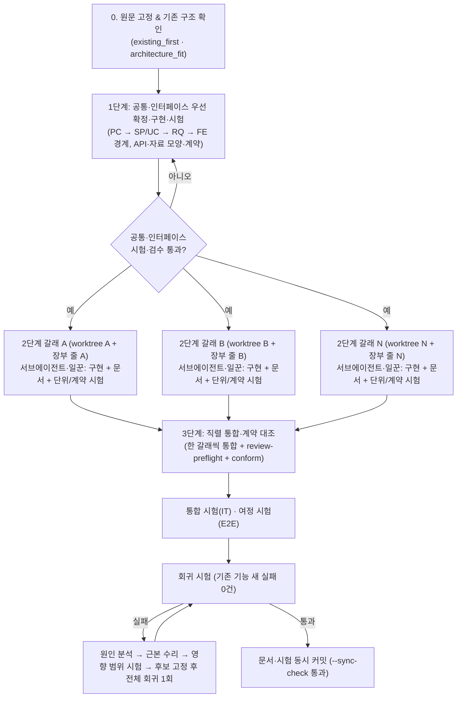

[English](development-method.en.md) | [한국어](development-method.md)

이 문서가 답하는 질문: Naia ADK에서 서비스·기능을 어떤 순서로 개발하고, 문서화·시험·회귀 검증을 어떻게 묶어 유지하는가?
상태: 현행 기준
기준판: 공개 저장소 `ed104d328ff7870908d326df840e4b98a1718a03`
범위: 공통

# Naia ADK 개발 방법 — 공통·인터페이스 선행, 병렬 동시 개발, 통합·회귀

이 문서는 Naia ADK에서 서비스와 기능을 설계·구현·검증·통합할 때 따르는 **단일 정본 개발 순서**와 **문서·시험 동시 갱신 규율**을 정의한다.

## 배경

2026-11-18 저장소 소유자 지시 원문:

- `05:25Z`: "공통개발 및 인터페이스를 우선 개발하고 모두 병렬로 개발할수 있도록해"
- `05:29~05:30Z`: "모든 서비스와 기능은 문서화, 테스트, 회귀테스트가 가능해야하고", "상위기획부터 통합테스트까지 다 있어야", "기능수정시 반드시 해당 부분도 수정되야하고"
- `05:32Z`: "서브에이전트들 적극활용해서 병렬로 빠르게 개발해"
- `05:33Z`: "병렬 개발시에는 아까 말했듯이 공통과 인터페이스부터 개발하고 병렬 동시개발 통합 순으로", "이것도 개발 방법에 대한 명시에 넣어줘"

기존 작업 흐름(`.agents/workflows/issue-driven-development.yaml`, `.agents/context/agents-rules.json`)과 하네스북(`hb-20261112` `bd8b50a`)에는 계약 우선(7장), 명세 사슬 추적(9·10장), 상향식 통합·선택적 회귀(12장), 역할 분리(15장), 병렬 작업 트리·직렬 통합 검수(20.2장)가 각각 나뉘어 있었고, 16장은 "서로 기대지 않는 일은 병렬로 돌린다"가 강제 장치 없이 원칙으로만 남은 틈을 기록했다. 이 문서는 그 절차를 하나의 실행 순서로 묶고, 커밋 단위 검사 대본과 연결한다.

---

## 전체 개발 흐름



---

## 1. 3단계 개발 순서

### 1단계: 공통·인터페이스 먼저 확정·구현·시험

병렬 개발에 들어가기 전에 모든 갈래가 기대는 **공통 부분**과 **경계 인터페이스**를 먼저 고정하고 검증한다.

1. **상위 기획부터 설계까지 경계 확정**:
   - `상위 기획(PC) → 화면·시나리오(SP/UC) → 요구사항(RQ) → 기능 설계(FE)` 순서에서 공통 모듈과 갈래 간 경계 인터페이스를 먼저 떼어 정의한다.
   - 기존 기능이 있는 작업이면 고치기 전에 기존 구현을 먼저 읽고(`existing_first`), [고치기 전 상위 구조·최초 요구 적합성](architecture-fit-before-fix.md)(`original_request`, `parent_structure`, `acceptance_rationale`)과 보존 대상(`preserves`)을 고정한다.
2. **인터페이스 명세 항목**:
   - **API 모양**: 함수·엔드포인트·CLI 명령 이름, 인자/매개변수, 반환 형식.
   - **자료 모양(스키마)**: 입출력 객체·JSON/YAML 스키마, 필수/선택 필드, 기본값, 허용 상태·전이.
   - **계약 및 실패 규약**: 선행·후행 조건, 오류 코드/예외 처리 방식, 구조화 디버그 로그·보존 정책([디버그 모드와 로그 원칙](debug-logging.md)).
3. **선행 구현 및 시험 고정**:
   - 공통 유틸리티·스키마·타입·포트 어댑터 경계를 먼저 구현하고 단위·계약 시험으로 통과시킨다.
   - 경계가 불안정하면 병렬 갈래를 열지 않는다. 1단계의 시험과 계획/계약 검토가 통과한 뒤에 2단계 갈래를 동시에 시작한다.

### 2단계: 인터페이스에 맞춰 갈래별 병렬 동시 개발

1단계에서 검증된 인터페이스 위에서 서로 의존하지 않는 기능·서비스 갈래들은 **서브에이전트**와 **일꾼(`scripts/worker-runner/spawn-worker.mjs`)**을 적극 활용해 병렬로 동시에 개발한다.

1. **갈래별 작업 트리 격리 (`git worktree`)**:
   - 같은 작업 트리에 여러 에이전트나 일꾼이 동시에 쓰지 않는다. 병렬 갈래마다 독립된 `git worktree`와 가지를 배정한다.
2. **갈래별 장부 줄 등록 (`scripts/work-ledger/ledger.mjs`)**:
   - 각 병렬 갈래는 [업무 장부와 10분 감시](../common/work-ledger.md)에 따라 역할 장부에 자기 줄(항목 ID, 역할, 지시서, 결과 파일, 상태, 기한)을 등록하고 추적한다.
   - 조정 세션(3층)은 직접 대량 구현하지 않고, 갈래별 문제·원인·수용 조건·모듈 분리 권한·검증 방법을 명시한 지시서로 2층 일꾼이나 서브에이전트에게 위임한다(`.agents/context/development-model-routing.yaml`, `docs/guides/lead-write-guard.md`).
3. **의존성 통제**:
   - 선행 갈래 결과에 기대는 작업은 선행 갈래의 시험·검수 통과 뒤에 착수한다.
4. **갈래 내 완결**:
   - 각 병렬 갈래는 인터페이스 계약 준수 확인과 함께 해당 갈래의 **기능 코드 + 문서 갱신 + 단위/계약 시험**을 빠짐없이 작성·통과시킨 뒤 통합으로 넘긴다.

### 3단계: 통합 → 통합 시험 → 회귀 시험

1. **직렬 통합 및 사전 검사**:
   - 병렬 개발을 마친 갈래는 한 번에 섞지 않고 **갈래마다 하나씩 직렬로 통합·검수**한다.
   - 통합 시 복잡도 게이트(`.agents/skills/review-pass/scripts/review-preflight.mjs`)와 계약-코드 드리프트 검사(`scripts/conform/oracle.py`)로 인터페이스 이탈(`signature-drift`, `contract-only`, `code-only`)이 없는지 확인한다.
2. **통합 시험(`IT`) 및 사용자 여정 시험(`E2E`)**:
   - 껍데기 호출이 아니라 실제로 연결된 경로(서버/CLI/API/저장소/상태 저장)로 통합 시험(`IT`)과 사용자 여정 시험(`E2E`)을 실행한다.
3. **회귀 시험 및 실패 우선 수리**:
   - 통합 후 기존 전체 시험 묶음을 실행해 기준선 대비 **새 실패 `0건`**을 확인한다.
   - 실패가 나면 전체 시험을 진단 도구로 반복 실행하지 않고 `실패 원문 확인·타당성 판단 → 근본 원인 수리 → 실패 항목·직접 영향 범위 선택 시험 → 최종 후보 고정 후 전체 회귀 1회` 순서로 닫는다(`rules/qa-and-debug-logging.md`).

---

## 2. 모든 서비스·기능의 문서화·시험·회귀 및 사슬 기준

모든 서비스와 기능은 개발이 끝난 뒤 따로 붙이는 것이 아니라 설계 시점부터 다음을 갖춰야 한다.

| 필수 요건 | 갖추어야 할 내용 | 확인 수단 / 기준 |
|---|---|---|
| **상위 기획~통합 시험 사슬** | `PC(상위 기획) → AC(동작 구조) → SP/UC(화면·시나리오) → RQ(요구사항) → FE(기능 명세) → UT/IT/E2E(시험 계획·실증) → QC(독립 적대 검증)` 연결 | 프로젝트 뼈대 `templates/project-skeleton/scripts/validate-spec-chain.mjs`, `rules/evidence-driven-process.md` |
| **문서화** | 아키텍처·계약(필드·상태·전이)·절차·검증 근거(저장소 상대 경로·심볼·기준판 SHA) | [개발 문서 작성 기준](dev-docs-writing.md) |
| **단위·통합 시험** | 기능 계약·경계값·실패 경로를 검증하는 단위 시험과 모듈 간 연결 통합 시험 | `*.test.*`, `tests/`, `scripts/it/`, `scripts/e2e/` |
| **회귀 시험 가능성** | 기준선 입출력·불변식·음성 사례가 자동 재실행 가능하며 디버그 로그·오류 근거가 남음 | [디버그 모드와 로그 원칙](debug-logging.md), `pnpm test` |

---

## 3. 기능 수정 시 문서·시험 동시 갱신 규율

1. **같은 커밋 원칙**:
   - 서비스·기능·공통 도구의 코드를 바꾸면, 그 변경에 대응하는 **문서**(`docs/`, `README*`, `rules/`, `.agents/context/`, `.agents/requirements/`)와 **시험**(`*.test.*`, `tests/`, `scripts/it/`, `scripts/e2e/`, `selftest_*.py`)을 **같은 커밋**에서 함께 고친다.
   - 코드만 바뀌고 문서나 시험이 빠진 커밋은 뒤처짐(drift) 원인이 되므로 완료로 보지 않는다(`.agents/context/agents-rules-detail.json` `ai_workflow.documentation_impact_policy`).
2. **결정론적 검사 (`scripts/check-guide-freshness.mjs`)**:
   - 기존 가이드 참조·뒤처짐 검사(`node scripts/check-guide-freshness.mjs`)와 함께, 커밋·스테이징·변경 파일 묶음의 문서·시험 동시 변경을 검사하는 `--sync-check` 모드를 제공한다.
   - 검사 항목:
     - 기능/서비스 코드가 바뀌었을 때 같은 변경 묶음 안에 **대응 문서**와 **대응 시험**이 함께 바뀌었는지(모듈/패키지/파일 식별자 일치 또는 문서·시험 내 경로·import 참조).
     - 함께 바뀐 `docs/` 문서 안의 상대 마크다운 링크(`[...](...)`)가 실제 저장소 파일로 풀리는지.
   - CI 연결(`.github/workflows/ci.yml`): `pull_request`에서 PR base 대비 변경 파일 범위(`--sync-check --range`)만 검사한다. 기존 열린 PR(29건 중 7건 미통과)과 설정·재내보내기·2-hop 시험 오탐으로 기존 PR을 깨지 않도록 초기에는 경고(`continue-on-error: true`)로 연결한다.

```bash
# 커밋/변경 집합의 코드↔문서↔시험 동시 갱신 및 문서 링크 검사
node scripts/check-guide-freshness.mjs --sync-check --commit HEAD
node scripts/check-guide-freshness.mjs --sync-check --staged
node scripts/check-guide-freshness.mjs --sync-check --range main..HEAD

# 검사기 자체 단위·회귀 시험
node --test scripts/check-guide-freshness.test.mjs

# 기타 공통 정합성 검사
node .claude/hooks/sync-entry-points.js --check
node scripts/check-context-budget.mjs
node .agents/hooks/core/agents-rules-load.test.js
node scripts/oss-readiness.mjs .
```

---

## 4. 기존 정의·하네스북과의 연결

| 구분 | 기존 위치 | 이 문서가 보완한 내용 |
|---|---|---|
| 전역 규칙 | `.agents/context/agents-rules.json` (`conventions.development_approach`, `detail.sections["ai_workflow.documentation_impact_policy"]`) | 3단계 개발 순서(공통·인터페이스 선행 → 병렬 → 통합/IT/회귀), 사슬 완결, 같은 커밋 동시 수정 한 줄 규율 + 이 문서 링크 |
| 기여·역할 배정 | `.agents/context/contributing.yaml`, `.agents/context/development-model-routing.yaml` | 병렬 갈래별 worktree + 장부 줄, 의존성 통제, 직렬 통합·회귀 반영 |
| 워크플로 | `.agents/workflows/issue-driven-development.yaml`, `.agents/workflows/development-cycle.yaml` | 단일 이슈 13단계의 Build/Review/Test/Sync 흐름에 공통·인터페이스 선행 및 갈래별 병렬 작업 절차 연결 |
| 규칙 카탈로그 | `rules/evidence-driven-process.md`, `rules/qa-and-debug-logging.md` | `PC → SP/UC → RQ → FE → UT/IT/E2E → QC` 사슬 및 실패 우선 검증·회귀 절차와 결합 |
| 하네스북 (`bd8b50a`) | 7장(계약), 8장(구조), 9·10장(추적성·명세 체인), 12장(상향식 통합·선택 회귀), 15·16장(역할 분리·원칙만 있고 장치 없음 틈), 20.2장(병렬 작업트리·의존성 통제·직렬 통합 검수) | 책에서 흩어져 있거나 원칙으로만 남아 있던 "인터페이스 선행 + 병렬 격리 + 동시 갱신"을 정본 순서와 `scripts/check-guide-freshness.mjs --sync-check`로 고정 |

---

## 5. 착수·통합 전 점검표

- [ ] 1단계: `PC → SP/UC → RQ → FE`에서 공통 모듈과 인터페이스(API·자료 모양·계약)를 먼저 확정·구현·시험했는가?
- [ ] 2단계: 병렬 갈래마다 독립 `git worktree`와 `work-ledger` 줄을 두고 서브에이전트·일꾼으로 실행했는가?
- [ ] 3단계: 갈래를 직렬로 통합하며 계약 드리프트(`conform`), 통합 시험(`IT`/`E2E`), 회귀 시험(새 실패 0건)을 통과했는가?
- [ ] 동시 갱신: `node scripts/check-guide-freshness.mjs --sync-check --commit HEAD`로 기능 코드 변경에 대응하는 문서·시험·링크가 같은 커밋에 포함됐는지 확인했는가?
