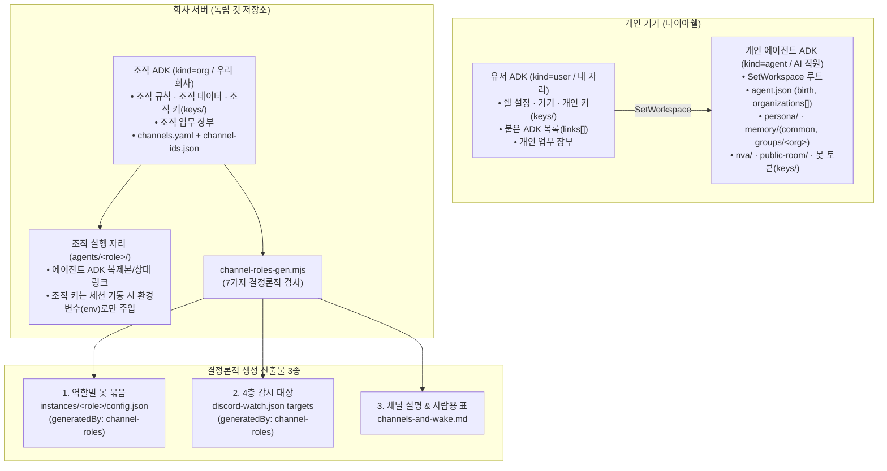

# 에이전트 중심 4종 ADK 구조·조직 실행 자리(`agents/<이름>/`) 및 사내 메신저 채널·담당 표(`channel-roles-gen`) 규율

범위: 공통 (`naia-adk` v0.2.0 표준 규칙 — `codesign.md` 1~11절 및 `adk-feature.md` 정본 반영)

---

## 1. 목적 및 6대 핵심 원칙

1. **에이전트 중심 루트 & 나이아쉘의 역할 분리**:
   - **나이아쉘(`naia-shell`)은 유저 ADK(`kind: "user"`)의 `adk.json`을 읽고, 그 안에 붙은 에이전트 ADK(`kind: "agent"`)들을 띄우는 그릇**이다.
   - 뇌(`naia-agent`) 프로세스가 `SetWorkspace(adkPath)`로 받는 작업 루트는 유저 ADK가 아니라 **에이전트 ADK 경로**다 (`에이전트 ADK 하나 = 뇌 프로세스 하나` 권장).
2. **에이전트 ADK의 고유 슬롯 (`birth`, `nva/`, `public-room/`, `memory/`)**:
   - `agent.json`과 `adk.json`의 `agent_config`에는 `birth`(`created_at` 만든 때, `created_by` 만든 이, `adk_version` 틀 판)와 소속 조직 이름 배열(`organizations` — 순환 링크 방지를 위해 링크가 아닌 이름 문자열만 기록)을 둔다.
   - 얼굴·목소리 아바타(`nva/`), 외부 에이전트가 방문하는 공개 방(`public-room/`, 내보내기 `export` 권한으로 통제), 그리고 공통 기억(`memory/common/`)과 조직별 격리 기억(`memory/groups/<org>/`)을 에이전트 ADK 안에 둔다.
3. **조직 실행 자리(`agents/<이름>/`)와 환경변수 키 주입 원칙**:
   - 조직 ADK(`kind: "org"`)의 `agents/<이름>/`은 해당 에이전트 ADK의 복제본(또는 같은 기기 내 상대 경로 소프트링크)이 놓이는 **조직 실행 자리**다.
   - **키 파일을 다른 ADK로 절대 복사하지 않는다**. 에이전트가 조직 키(회사 AI 구독, 인프라 권한 등)가 필요한 일을 할 때는 ① 회사 서버의 조직 자리(`agents/<이름>/`)에서 뜬 세션에만 ② 조직 ADK 실행기가 시작 시 **환경변수(`env_only`)로만 주입**하고 ③ 에이전트 ADK 파일이나 자식 로그에는 남기지 않는다.
4. **업무 장부(`.agents/work`, 진행 기록)의 에이전트 ADK 배제**:
   - 실행 상태·계약·진행 기록(업무 장부)은 업무 주체를 따라 **조직 업무는 `org` ADK, 개인 업무는 `user` ADK, 제품 이슈는 `project` ADK**에 둔다.
   - **에이전트 ADK에는 기억·성격·설정만 쌓고 업무 장부는 두지 않는다** (`work_ledger_prohibited: true`). 이로써 한 에이전트가 여러 조직에 속하더라도 조직 간 업무 기록이 섞이지 않는다.
5. **설정 우선순위 (`실행 인자 > 프로젝트 > 에이전트 > 유저 > 조직 > 틀`)**:
   - 먼저 항목별 소유를 나눈다(화면·기기·계정 = `user`, 말투·모델·NVA·기억 = `agent`, 제품·시험·배포 = `project`, 조직 규칙·채널 표 = `org`).
   - 불가피하게 겹치는 일반 설정만 **`실행 인자(cli_args) > 프로젝트(project) > 에이전트(agent) > 유저(user) > 조직(org) > 틀(framework)`** 순서를 따른다. 단, **권한·금지(` 부여 ∩ 상한 − 금지`)와 비밀키(`keys/`) 소유는 이 우선순위와 무관**하게 엄격히 계산한다.
6. **사내 메신저 채널·담당 표의 3자리 구조와 결정론적 생성기 (`channel-roles-gen.mjs`)**:
   - 어느 채널에 어느 역할이 초대되었고 누가 주 담당(`primaryRole`)인지 한 곳(`channels.yaml` + `channel-ids.json`)에 적고, 생성기(`scripts/channel-roles-gen.mjs`)로 **① 역할별 봇 묶음(`discord.bindings`), ② 4층 감시 대상(`discord-watch.json`), ③ 채널 설명 및 사람용 문서(`channels-and-wake.md`)** 셋을 한 번에 만들어 어긋남을 원천 차단한다.

---

## 2. 4종 ADK 관점·키 경계 및 채널 표 3자리 아키텍처



### 2.1 각자의 관점 (보는 것 vs 못 보는 것)

| 관점 (`kind`) | 고객 표시 이름 | 보는 것 (`adk.json` `links` 안) | 절대 못 보는 것 | 업무 장부 보유 |
|---|---|---|---|---|
| **`user`** | 내 자리 | 붙은 에이전트·프로젝트·조직 목록, 각 에이전트 상태·NVA·설정, 자기 기기·계정 | 조직 키, 구성원 권한 밖 조직 폴더, 다른 유저 | 보유 (개인 업무) |
| **`agent`** | AI 직원 | 소유 유저 식별자, 소속 조직 이름(문자열), 참여 프로젝트, 자기 기억·규칙·키 | 다른 에이전트 기억·키, 현재 실행 자리 밖의 다른 조직 기억·데이터·키, 유저 키 | **금지** (`work_ledger_prohibited`) |
| **`project`** | 만드는 것 | 참여 에이전트 이름들, 소유 조직/유저, 제품 명세·이슈·검증 기록, 프로젝트 자체 키 | 에이전트 기억, 다른 ADK의 키 | 보유 (제품 이슈·검증) |
| **`org`** | 우리 회사(기관) | 조직 에이전트 묶음(`agents/<이름>/`), 조직 프로젝트, 구성원 식별자, 조직 키·규칙·채널 표 | 구성원 유저의 개인 에이전트·개인 데이터, 공유 허용 안 된 `memory/common/` 및 타 조직 기억 | 보유 (조직 업무) |

---

## 3. 채널·담당 표 3자리 구조와 파일 규격

| 자리 | 담당 ADK | 정본 파일 및 역할 | 보안·격리 원칙 |
|---|---|---|---|
| **1. 공통 틀** | `naia-adk` (프레임워크) | `schemas/channels.schema.json`, `scripts/channel-roles-gen.mjs`, `templates/org-channels/` | 특정 회사의 실제 채널·사용자 번호를 넣지 않고 가짜 번호 예시만 포함 |
| **2. 조직 설정 표** | `org` ADK (회사별) | `channels.yaml` (역할 이름·규칙만, 번호 없음) + `channel-ids.json` (서버/채널 실제 번호, `allowedUserIds`, `readerInstance`) | 회사마다 별도 표(`nextain`, `onmam` 등). 한 조직이 사내 서버(`internal`)와 고객 서버(`customer`) 등 복수 서버 보유 가능 |
| **3. 에이전트 키** | `agent` ADK (역할별) | 각 에이전트 ADK의 `keys/` 안 봇 토큰 | 조직 표(`wakeRoles`)가 허용해도 에이전트 ADK에 토큰이 없으면 못 쓰고, 토큰이 있어도 표에 없으면 못 씀 ("자기 봇으로만 답함" 보장) |

---

## 4. `channel-roles-gen.mjs` 명령 및 7가지 결정론적 검사

### 4.1 실행 명령

```bash
# 미리보기 (기본값 — 파일 미수정, 요약 및 건너뛴 서버 출력)
node projects/naia-adk/scripts/channel-roles-gen.mjs \
  --table channels.yaml \
  --ids channel-ids.json \
  --out-dir .

# 실제 기록 (--write 지정 시 기존 파일을 .bak-<YYYYMMDD>로 백업한 뒤 기록)
node projects/naia-adk/scripts/channel-roles-gen.mjs \
  --table channels.yaml \
  --ids channel-ids.json \
  --out-dir . \
  --write
```

### 4.2 7가지 결정론적 검사 (하나라도 위반 시 종료코드 1 & 파일 쓰기 전면 중단)

| 검사 번호 | 결정론적 검증 규칙 | 위반 시 동작 |
|---|---|---|
| **검사 1** | 표의 모든 역할(`wakeRoles`, `primaryRole`)은 해당 회사 `roles` 목록 안에 있어야 하며, `wakeRoles`는 비어있거나 중복될 수 없다. | 종료코드 `1`, 파일 미수정 |
| **검사 2** | `primaryRole`은 반드시 그 채널의 `wakeRoles` 안에 포함되어야 하며, `outsideCall`은 `mention` 또는 `mention-or-name`만 허용한다. | 종료코드 `1`, 파일 미수정 |
| **검사 3** | 채널 열쇠(`key`)는 회사 안에서 유일해야 하며, `guildId`가 `null`이 아닌 모든 서버의 채널 열쇠는 `channel-ids.json`에 실제 번호가 있어야 한다 (`guildId: null`인 미생성 서버는 건너뛰고 출력에 표시). | 종료코드 `1`, 파일 미수정 |
| **검사 4** | 같은 실제 채널 번호(Snowflake ID)가 두 채널 열쇠나 두 회사에 중복 등장하면 거절한다. | 종료코드 `1`, 파일 미수정 |
| **검사 5** | 사내 공지 채널(`teamMessengerChannelId`)은 채널·담당 표에 넣을 수 없다 (4층 감시 기본 규칙과 동일). | 종료코드 `1`, 파일 미수정 |
| **검사 6** | 대상 디렉토리에 각 역할의 봇 묶음 설정 파일(`instances/<role>/config.json`)이 없으면 거절한다 (단, `--init-instances` 명시 시 초기 생성 허용). | 종료코드 `1`, 파일 미수정 |
| **검사 7** | 생성·병합된 4층 감시 대상(`targets`)이 필수 필드(`kind: "channel"`, `guildId`, `channelId`, `wakeRoles`, `primaryRole`, `outsideCall`, `includeThreads: true`, `readerInstance`, `generatedBy: "channel-roles"`) 무결성을 통과하는지 자체 검증한다. | 종료코드 `1`, 파일 미수정 |

### 4.3 수동 항목 보존 및 서버 이전(`archived: true`) 규칙

1. **수동 묶음·감시 대상 보존**:
   - `generatedBy: "channel-roles"` 표지가 없는 기존 수동 봇 묶음(예: 사내 공지 채널, 옛 전용 채널)과 기존 4층 감시 대상(예: 온맘 통합 쓰레드, 옛 아이폴 채널)은 삭제하거나 덮어쓰지 않고 그대로 보존한다.
2. **서버 이전 및 보관 채널(`archived: true`) 처리**:
   - 채널을 고객 서버나 새 서버로 옮긴 뒤 옛 채널의 4층 감시를 멈추려면, 옛 채널을 표에서 지우지 않고 `archived: true`를 표시한다.
   - `archived: true` 채널은 **4층 감시 대상(`discord-watch.json` `targets`)에서는 즉시 제외**되지만, **역할별 봇 묶음(`discord.bindings`)에는 읽기 전용(`operatorActions: false`, `readOnly: true`, `archived: true`)으로 유지**되어 과거 기록 조회가 보존된다.
