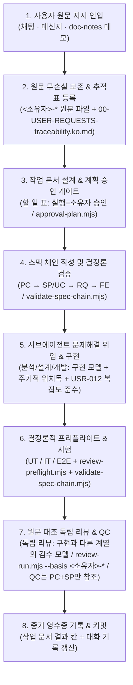

# 증거 기반 개발 프로세스 — 사용자 원문 추적·계획 승인·스펙 체인 및 분리 검수

범위: 공통 (`naia-adk` v0.2.0 표준 규칙)

---

## 1. 핵심 원칙

1. **사용자 원문 무손실 보존**:
   - 사용자의 모든 지시·요구·정정 발언은 요약하거나 생략하지 않고 원문 그대로 출처 파일(`<소유자>-*` 원문 파일 / 원문 기록, 접두어는 인스턴스가 정한다)과 추적 매트릭스(`00-USER-REQUESTS-traceability.ko.md`)에 고정한다.
2. **계획 승인 후 구현 (`approval-plan.mjs`)**:
   - 주요 기능·아키텍처·프로세스 변경은 작업 문서의 `## 할 일` 표에 승인 게이트 줄(`실행=소유자 승인`)을 두고, 승인 대기 표(`data-local/approval-plans.json`)에서 승인된 뒤에만 하위 구현 작업을 시작한다.
3. **양방향 스펙 체인 (`PC → SP/UC → RQ → FE → [UT/IT/E2E] → QC`)**:
   - 상위 기획(`PC`)부터 화면 기획(`SP`)·사용자 여정(`UC`)·요구사항(`RQ`)·기능 명세(`FE`)·시험(`UT/IT/E2E`)·독립 적대 검증(`QC`)까지 모든 산출물을 ID로 연결하고 `validate-spec-chain.mjs`로 무결성을 강제한다.
4. **구현 모델과 독립 리뷰 모델의 엄격한 분리**:
   - 분석·설계·개발(구현)을 수행한 모델 계열과 코드·산출물을 검수하는 리뷰 모델 계열은 반드시 분리한다(공통 규칙은 역할과 '구현 계열 ≠ 검수 계열'만 정한다. 역할마다 실제로 쓰는 모델은 인스턴스가 `FORK.md` 같은 덮어쓰기 위치에 적는다).

---

## 2. 엔드투엔드 증거 기반 파이프라인



---

## 3. 단계별 필수 규율과 검증 도구

### 3.1 사용자 원문 추적 매트릭스 (`00-USER-REQUESTS-traceability.ko.md`)

모든 프로젝트와 주요 작업 묶음은 아래 열 구조를 가진 원문 추적 문서를 유지한다.

| 요구 ID (`REQ-*`) | 출처 / 시각 | 사용자 원문 (요약·변형 금지) | 반영 문서·규칙·스펙 ID (`PC/SP/UC/RQ/FE`) | 검증 스크립트·증거 경로 | 상태 |
|---|---|---|---|---|---|
| `REQ-01` | 메신저 / 문서 메모 | `"원문 그대로 인용"` | `RQ-001`, `FE-001`, 규칙 경로 | `validate-spec-chain.mjs`, 시험 결과 경로 | `반영 완료` |

- **검수 차단 조건 (원문 근거 필수)**: `review-run.mjs` 실행 시 `--basis`에 사용자 원문 출처 파일(`<소유자>-*`)이 포함되지 않거나, 검수 후 원문 해시가 바뀌면 해당 검수 PASS는 즉시 무효 처리된다.

### 3.2 계획 승인 워크플로우 (`.agents/scripts/approval-plan.mjs`)

- 작업 문서(`docs/developer/**/work/*.md`)의 `## 할 일` 표에서 `실행` 열이 `소유자 승인`이고 `상태`가 `대기`인 줄을 자동 수집해 `data-local/approval-plans.json`에 등록한다.
- 대시보드에서 승인(`approve`)하면 작업 문서의 해당 줄이 `끝 (<날짜> 소유자 승인)`으로 갱신되고 다음 대기 줄(구현 서브에이전트)이 활성화된다.
- 반려(`reject`) 또는 보류(`hold`) 시 사유가 작업 문서의 `## 대화 기록` 절에 자동 기록되며, 설계를 보완해 재승인을 받는다.

### 3.3 스펙 체인 무결성 검증 (`validate-spec-chain.mjs`)

기능 단위 개발은 아래 8단계 사슬의 양방향 참조와 정보 장벽을 지킨다.

1. **`PC` (Product Concept)**: 제품 헌장, 해결하려는 가치, 핵심 불변식.
   - **`AC` (Architecture Concepts)**: `PC` 바로 다음에 읽는 동작 구조·개념 설명(`08-AC-architecture-concepts.ko.md`). 처음 보는 사람을 위한 한 문단 요약, 낱말 풀이, 구성 요소, 요청에서 결과까지의 흐름, 데이터 저장 위치, 바깥 연결을 적는다. 사슬 단계를 늘리지 않으며 `QC` 의 기준 문서도 아니다.
2. **`SP` (Screen Plan) / `UC` (User Scenario)**: 화면 공간 배치(`SP`)와 사용자 해피패스/예외 여정(`UC`).
3. **`RQ` (Requirements)**: 검증 가능한 수용 기준과 사용자 원문(`REQ-*`) 연결.
4. **`FE` (Feature Spec)**: 모듈 책임, API/상태 계약, 디버그 로깅(`D47`) 및 복잡도(`USR-012`) 설계.
5. **`UT` / `IT` / `E2E` (Verification)**: 개발 트랙의 단위·통합·엔드투엔드 시험.
6. **`QC` (Independent Adversarial Validation)**:
   - **정보 장벽(Information Barrier)**: `QC`는 개발자의 각본(`UC`)과 내부 구현(`FE`)을 보지 않고 오직 **`PC`(제품 약속)와 `SP`(화면 기획)**만을 기준으로 적대적 시나리오·경계 입력·안전성 불변식을 시험한다.

```bash
# 스펙 체인 링크·고아 문서·추적성 결정론적 검증
node scripts/validate-spec-chain.mjs
```

### 3.4 역할별 모델 분리 및 서브에이전트 운영 표준

공통 규칙은 층(1층 센서 · 2층 실행·검수 · 3층 조정 · 4층 자문)과 역할, 모델이 갖춰야 할 조건만 정한다. 역할마다 실제로 어느 모델을 쓰는지는 인스턴스가 `FORK.md` 같은 덮어쓰기 위치에 적는다.

| 단계 | 담당 주체 | 모델 조건 (실제 모델은 인스턴스가 정함) | 필수 안전장치 |
|---|---|---|---|
| **센서·깨우기 (1층)** | 외부 감시 + 경량 교차 센서 | 경량 모델 기본 + 다른 공급자 계열 경량 모델 교차 | 메신저·서브에이전트 완료/무응답·`doc-notes` 메모 감지 시 3층 깨움 |
| **분석·설계·개발 (2층 실행)** | 서브에이전트 (`invoke_subagent` / 워커) | 주력 구현 모델 (중간 추론 수준) | 문제·근본 원인·목표·수용 조건 광범위 위임 + 모듈 분리·리팩토링(`USR-012`) |
| **독립 리뷰 (2층 검수)** | 독립 검수기 (`review-run.mjs`) | 구현 모델과 다른 계열의 검수 모델 (높은 추론 수준) | 구현 모델과 반드시 다른 모델 사용; `--basis` 원문 파일 필수; 지시서 검수 1회·코드 검수 최대 2회 상한 |
| **지휘·조율 (3층)** | 메인 오케스트레이터 · 역할 세션 | 상위 조율 세션 | 직접 대량 구현 금지; 서브에이전트 위임 시 **주기적 워치독 타이머** 필수 설정 |
| **상위모델 적대 검토 (4층 자문)** | 플래그십 리뷰어 (`/top-model-review`) | 상위 추론 모델 (여러 계열 중 하나) | 사용자 명시 요청("상위모델 검토해줘") 또는 3층 해결 불가 난제 시 1회 호출 |

층 번호는 아래에서 위로 센다. 일은 아래층에서 먼저 하고 못 푸는 것만 위층으로 올린다. 2026-10-20 전 문서의 옛 번호(위에서 아래)는 1층↔4층, 2층↔3층이 뒤바뀐 것이다.

### 3.5 리뷰어 지적의 증거 검증 (`review_finding_validation`)

- 리뷰어의 지적은 사실이나 명령이 아니라 **검증 전 가설(Hypothesis)**이다.
- 조정자는 모든 FAIL 원문을 직접 읽고 사용자 원문·스펙(`PC/SP/RQ`)·실제 코드/런타임과 대조해 `ACCEPTED`(채택·수정), `REJECTED`(기각 및 사유 보존), `UNRESOLVED`(근거 부족·사용자 확인)로 판정 기록한다.
