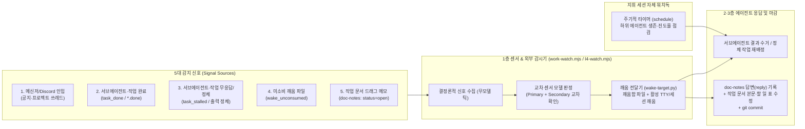

# 1층 센서 아키텍처·서브에이전트 주기적 워치독 및 작업 문서 메모(`doc-notes`) 루프

범위: 공통 (`naia-adk` v0.2.0 표준 규칙)

> 층 번호는 아래에서 위로 센다(1층 센서 · 2층 실행·검수 · 3층 조정 세션 · 4층 자문, 2026-10-20 개편). 파일 이름과 스크립트 이름(`layer4-*`, `l4-*`)은 옛 번호(위에서 아래) 시절 이름을 그대로 둔 것이다.

---

## 1. 목적 및 핵심 원칙

1. **지휘 세션의 외부 알림 수동 대기 금지**:
   - 지휘(오케스트레이션, 3층) 세션이 서브에이전트나 백그라운드 작업을 띄운 뒤 상대의 완료 알림에만 의존해 멈춰 있으면, 하위 에이전트 타임아웃·크래시·무응답 시 프로젝트 전체가 영구 정지한다.
   - 따라서 **서브에이전트를 호출하는 모든 지휘 세션은 호출 즉시 주기적 워치독 타이머(`schedule` 도구 등)와 1층 센서를 반드시 함께 설정**해야 한다.
2. **1층(Tier-1)은 상시 센서(Sensor)다**:
   - 모델이 루프를 돌며 대기하는 대신, 결정론적 외부 감시 스크립트(`work-watch.mjs`, `l4-watch.mjs`)와 저비용·고속 1층 센서 모델(교차 검증 구성)이 외부 사건과 내부 작업 상태를 주기적으로 감지해 필요한 순간에만 지휘 세션을 깨운다.
3. **작업 문서 드래그 메모(`doc-notes`)의 무폴링 폐루프**:
   - 사용자가 대시보드/포털 작업 문서에서 특정 구절을 드래그해 남긴 메모(`doc-notes`)는 1층 센서가 즉시 감지하여 담당 작업 세션을 깨우고, 에이전트는 **답변(`reply`) + 문서 본문/할 일 표 반영 + `git commit`**까지 한 호흡으로 처리한다.

---

## 2. 아키텍처 및 데이터 흐름

---

## 3. 서브에이전트 무응답 방지 (주기적 워치독 규율)

지휘 세션이 서브에이전트(`invoke_subagent`) 또는 비동기 작업(`run_command` 백그라운드, 원격 러너, systemd 작업)을 실행할 때 다음 절차를 강제한다.

1. **호출 시 워치독·정체 상한 설정**:
   - 서브에이전트를 띄울 때는 단계 시간 예산(예: 분석 15분, 구현 30분) 기반의 정체 감시 상한(`TimerCondition="any"` 또는 1층 외부 센서 `work-watch.mjs` / `l4-watch.mjs`)을 설정한다.
2. **정상 진행 중 침묵(Silent Monitoring) 및 화면 오염 금지**:
   - 서브에이전트가 시간 예산 안에서 정상 작동 중일 때는 **사용자 대화 화면에 "아직 진행 중입니다 / 곧 이어가겠습니다" 같은 중간 확인 타이머 메시지를 절대 출력하지 않는다**.
   - 짧은 주기(예: 2~3분)의 모델 턴 깨움 타이머를 반복 호출해 사용자 채팅창에 불필요한 중간 응답이 찍히게 하는 것은 금지하며, 백그라운드 감시는 조용히 수행하고 **실제 완료(`task_done`) 또는 시간 예산 초과 무응답·오류(`task_stalled`)가 발생했을 때만** 세션을 깨워 후속 조치를 수행한다.
3. **생존 확인이 아닌 진도율 확인**:
   - 정체 임계 시각에 도달해 상태를 점검할 때는 단순히 프로세스가 살아 있는지만 보지 않고, **최근 체크포인트 산출물 갱신 시각·완료 단계·수용 조건 진도율**이 올라갔는지 확인한다.
4. **무응답·정체 시 즉시 개입**:
   - 단계 시간 예산 동안 실질 산출물 진전이 없거나 에이전트가 오류로 멈춘 경우, 실패 원문과 남은 수용 조건을 회수해 즉시 재기동하거나 대체 경로로 재배정한다.

---

## 4. 1층 교차 센서 구성 (Cross-Model Sensor)

단일 공급자의 속도 제한(Rate Limit)이나 단일 경량 모델의 반복 오판으로 중요한 깨움 신호가 누락되는 일을 막기 위해 1층 센서는 두 개 이상의 경량 모델을 교차 배치한다.

- **주 센서 모델(`sensor_primary`)**: 주 코딩/큐레이션 쿼터와 분리된 고속 모델 (예: `gemini-3.8-flash-low`)
- **보조 센서 모델(`sensor_secondary`)**: 다른 공급자 계열의 경량 모델 (실제 모델은 인스턴스가 덮어쓰기 위치에 적는다)
- **교차 판정 규칙**:
  1. 사람 직접 지시, 장애·긴급 키워드, 결정 요청, 작업 문서 메모(`doc-notes`), 서브에이전트 완료/정체 신호는 모델 분류 없이 **결정론적 코드 규칙으로 즉시 깨움(`wake`)** 처리한다.
  2. 애매한 일반 메시지는 두 모델에게 독립 판정을 요청해 **하나라도 `wake`를 반환하면 깨우며**, `ignore`로 판정된 사건은 다음 주기에 다른 계열 모델이 재검토한다.

---

## 5. 작업 문서 드래그 메모 (`doc-notes`) 처리 루프 표준

### 5.1 데이터 스키마 (`doc-notes.json` / `.agents/work/doc-notes/`)

| 필드 | 타입 | 설명 |
|---|---|---|
| `id` | `string` | 메모 고유 식별자 |
| `path` | `string` | 대상 작업 문서 경로 (예: `docs/developer/pipeline/work/P-03-....md`) |
| `quote` | `string` | 사용자가 문서에서 드래그해 선택한 원문 구절 |
| `body` | `string` | 사용자의 질문·수정 지시(이어 쓰기 시 `--- 사용자 (시각)` 누적) |
| `status` | `"open" \| "resolved"` | 미해결(`open`) 또는 사용자 확인 완료(`resolved`) |
| `reply` | `string` | AI의 답변 및 조치 내역 (`--- AI (시각)` 누적) |
| `updatedAt` | `string` | 마지막 수정 ISO 시각 |

### 5.2 처리 4단계 (감지 → 깨움 → 문서 반영 → 커밋)

1. **감지 (`work-watch.mjs`)**:
   - `status === "open"`이면서 `reply`가 비어 있거나 사용자 후속 입력으로 `updatedAt > lastHandledAt`인 메모를 찾는다.
2. **깨움 (`wake-target.py`)**:
   - 메모가 달린 문서(`path`)의 담당 세션(`담당:` 프론트매터 또는 활성 세션 매핑)을 찾아 깨움 신호와 메모 원문(`quote`, `body`)을 전달한다. 활성 세션이 없으면 원샷 응답 에이전트를 기동한다.
3. **답변 및 문서 본문 수정**:
   - 질문이면 근거를 확인해 `reply`에 간결한 한국어 답변을 기록한다.
   - 문서·계획·규칙 수정 지시이면 해당 작업 문서의 본문, `## 할 일` 표, `## 대화 기록` 절을 즉시 수정하고 `reply`에 변경 위치와 요약을 적는다. (메모의 `status`를 AI가 임의로 `resolved`로 닫지 않는다 — 닫기는 사용자 권한).
4. **버전 고정 (`git commit`)**:
   - 수정된 작업 문서와 메모 응답 상태를 검증한 뒤 `git commit`까지 완료해 대시보드와 저장소 정본이 즉시 일치하게 한다.
