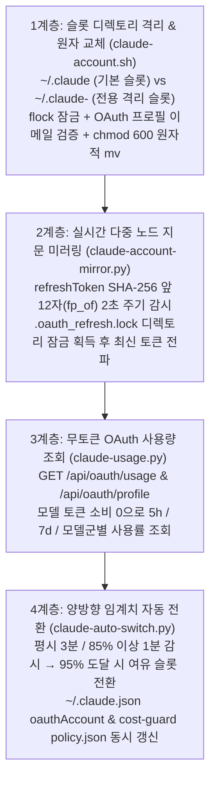

# 멀티 CLI 및 Claude Code 다중 계정·구독 통합 관리 표준

범위: 공통 (`naia-adk` v0.2.0 표준 규칙 — 개인 식별자·비밀값·내부 호스트명을 제외한 역할/슬롯 추상화 정본)

---

## 1. 목적 및 해결 과제

복수의 AI CLI 도구(`claude`, `codex`, `agy`, `muse`, `grok`, `opencode`)와 복수의 구독 계정(`primary_personal` 계정 + `secondary_org` 전용 계정)을 여러 개발 기기(`host_main`, `host_remote_srv`, `host_aux_win`)에서 운영할 때 다음 세 가지 장애를 방지한다.

1. **단일 사용 OAuth 리프레시 토큰 경쟁 (Single-Use Refresh Token Race)**:
   - 한 기기나 프로세스가 OAuth 토큰을 갱신하면 이전 `refreshToken`이 즉시 폐기되어 다른 기기·창의 인증이 끊기는 현상.
2. **계정 신원 오염 (Identity Contamination)**:
   - 계정 전환 전후로 실행 중이던 다른 계정의 프로세스가 공용/전용 인증 파일을 자기 토큰으로 덮어써 원격 서버에 잘못된 계정이 전파되는 현상.
3. **단일 계정 쿼터 소진에 따른 파이프라인 정지**:
   - 5시간(5h) 또는 7일(7d) 롤링 한도가 임계치에 도달했을 때 수동 개입 전까지 자동화·검수·4층 센서가 멈추는 현상.

---

## 2. Claude Code 4계층 다중 계정 관리 표준 아키텍처

### 2.1 1계층: 설정 디렉토리 격리 및 신원 검증 (`claude-account.sh`)

- **창 단위 격리 (`CLAUDE_CONFIG_DIR=~/.claude-<slot>`)**:
  - 전용 슬롯 디렉토리(`~/.claude-<slot>`)는 `.credentials.json`과 `.claude.json`(`oauthAccount` 제거본)만 독립 파일로 유지하고, 나머지(`settings.json`, `hooks/`, `projects/`, `skills/` 등)는 기본 `~/.claude`로 심볼릭 링크한다.
  - 이를 통해 하네스 훅과 스킬·기억은 100% 공유하면서 특정 터미널 창만 독립된 계정으로 실행한다.
- **기본 활성 계정 전환 (`use <slot>`)**:
  - 기본 `~/.claude/.credentials.json`을 대상 슬롯 인증으로 교체하여 실행 중인 모든 세션이 즉시 새 계정을 사용하게 한다.
- **파일 잠금 및 신원 오염 방지 불변식**:
  1. 모든 인증 파일 쓰기는 `~/.claude/.mutation.lock`(`flock`) 아래에서 임시 파일(`chmod 600`) 생성 후 `mv -f` 원자 교체로 수행한다.
  2. 원격 호스트(`host_remote_srv`)로 전용 슬롯 토큰을 보낼 때는 반드시 `/api/oauth/profile`을 호출해 실제 토큰 소유 이메일이 전용 계정(`expected_org_email`)과 일치하는지 검증한다. 불일치 시 동기화를 즉시 중단한다.
  3. 원격 호스트의 기본 활성 파일(`~/.claude/.credentials.json`)은 덮어쓰지 않고 전용 슬롯 보관 파일(`~/.claude-<slot>/.credentials.json`)만 갱신하여 폴백 경로를 보호한다.

### 2.2 2계층: 실시간 다중 호스트 토큰 지문 미러링 (`claude-account-mirror.py`)

- **토큰 세대 지문 (`fp_of`)**:
  - `claudeAiOauth.refreshToken`의 SHA-256 해시 앞 12자리와 만료 시각(`expiresAt`)을 조합해 토큰 세대를 식별한다.
- **네이티브 잠금 호환**:
  - 로컬 및 SSH 원격 노드에 토큰을 쓸 때 Claude CLI의 네이티브 `.oauth_refresh.lock` 및 `realpath.lock` 디렉토리 잠금을 먼저 획득한 뒤 원자적으로 교체하여, CLI 자체 갱신 루프와의 경쟁 조건(Race Condition)을 제거한다.

### 2.3 3계층: 무토큰 OAuth 사용량 관측 (`claude-usage.py`)

- 모델 호출(`claude -p`)로 쿼터를 소모하지 않고 OAuth 사용량 API(`/api/oauth/usage`)를 직접 조회해 `five_hour`, `seven_day`, `seven_day_opus`, `seven_day_sonnet`, `extra_usage` 지표를 JSON/표로 수집한다.
- 만료 임박 토큰은 조회 과정에서 OAuth 토큰 엔드포인트로 선제 갱신해 미러링 계층과 공유한다.

### 2.4 4계층: 양방향 임계치 자동 전환 및 비용 가드 동기화 (`claude-auto-switch.py`)

- **적응형 감시**: 평시 3분 주기, 활성 계정의 `max(five_hour, seven_day) >= 85%` 도달 시 1분 주기로 감시한다.
- **자동 전환 (기본 임계치 `95%`)**:
  - 활성 계정이 임계치 이상이고 예비 계정이 임계치 미만이면 즉시 예비 계정으로 전환한다.
  - 전환 시 (1) `.credentials.json`, (2) `.credentials.active`, (3) `~/.claude.json`의 `oauthAccount`, (4) `~/.claude/cost-guard/policy.json`의 `expectedEmail`을 한 번에 갱신해 하네스 훅 차단을 방지한다.
- **양쪽 소진 경보**:
  - 모든 슬롯이 임계치를 초과하면 가장 빠른 리셋 시각을 계산해 운영 채널로 **단 1회** 알림을 보내고, 리셋 전까지 중복 알림을 억제한다.

---

## 3. 멀티 CLI 역할 분리 및 프로파일 라우팅 표준

특정 공급자의 쿼터 소진이나 장애가 전체 워크스페이스를 멈추지 않도록 CLI 도구별 역할을 분리한다.

| 역할 계층 | 권장 담당 CLI / 모델군 | 분리 및 폴백 원칙 |
|---|---|---|
| **1층: 플래그십 적대 검토 (`tier1_flagship_review`)** | 상위 추론 모델 (`fable` / `argon high` / `astra`) | 난제 해결 및 `/top-model-review` 요청 시에만 호출 |
| **별도: 큐레이션·캐릭터 (`tier_curation`)** | 고정밀 창작 모델 (`opus 5.5 xhigh`) | 일반 코딩·반복 구현에서 쿼터 소진 금지 |
| **2·3층: 분석·설계·개발 (`tier2_3_architect_dev`)** | 주력 코딩 서브에이전트 (`agy` / `argon medium`, 보조 `3.8 flash` 또는 시나리오 B `6.1 sol` / `luna-max`) | 문제·근본 원인·목표·수용 조건 광범위 위임 + 주기적 워치독 타이머 필수 |
| **3층: 독립 리뷰 (`tier3_independent_review`)** | 교차 계열 검수 모델 (`muse 1.3 xhigh` / 보조 `sonnet 5.5` / 선택적 `opencode`) | **구현 모델과 반드시 다른 모델 계열** 사용 (`review-run.mjs`) |
| **4층: 상시 센서·깨우기 (`tier4_sensor`)** | 경량 교차 모델 (`3.8 flash` 기본 + `luna-max` / `haiku` 보조) | 코딩·큐레이션 쿼터 한도에 막히지 않는 별도 공급자 우선 + 2모델 교차 판정 |

### 3.1 카탈로그 기반 프로파일 런처 (`personal-model-profile.mjs`)

- 각 역할에 바인딩된 모델·추론 강도(`effort`)·권한 티어(`readonly`, `workspace_write`)를 중앙 카탈로그로 관리하고, 호출자가 임의 플래그로 모델이나 권한을 우회하지 못하게 검증한다.
- 원격 다중 호스트에서 단일 사용 refresh token을 쓰는 CLI(`codex` 등)는 인증 파일을 무분별하게 수동 복사하지 않고, 호스트별 역할 분리 또는 잠금 기반 미러링 스크립트를 통해서만 운영한다.
