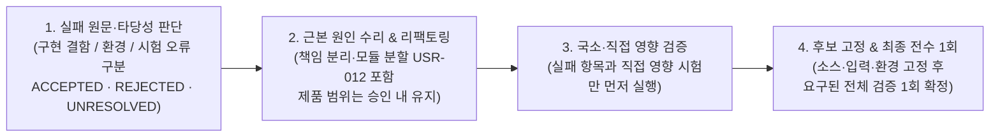

# QA 실패 우선 검증(Failure-First Validation) 및 기본 구조화 디버그 로깅(`D47`) 규칙

범위: 공통 (`naia-adk` v0.2.0 표준 규칙)

---

## 1. 목적 및 배경

복합 AI 서비스·스튜디오·멀티 에이전트 시스템의 QA와 장애 대응에서 발생한 23건의 실측 시간·비용 낭비 사례와 25개 재발 방지 절차를 `naia-adk` 표준 규칙으로 추상화한다. 또한 원인 추적 시간을 단축하기 위해 **모든 서비스·배치·모듈에 기본 ON 디버그 모드와 구조화 로그·메모리 링버퍼·정리 배치를 처음부터 내장하는 원칙(`D47`)**을 강제한다.

---

## 2. 실패 우선 검증 (Failure-First Validation) 4단계 순서

실패가 발생했을 때 무관한 전체 시험을 처음부터 재실행하거나 증상만 가리는 임시 분기를 덧대지 않고 반드시 아래 4단계를 따른다.



1. **실패 원문 및 타당성 확인**:
   - 실패 로그의 대상·후보·입력·환경·시각을 확인하고, 시험의 `import → 호출 → assertion` 및 요구사항과 대조해 실패 자체의 타당성과 근본 원인을 먼저 판단한다.
   - 통과시키려고 assertion이나 수용 조건을 낮추는 행위를 엄금한다. 틀린 검수 지적은 `REJECTED`와 근거를 남기고 제품 코드를 바꾸지 않는다.
2. **근본 원인 수리 및 모듈 단순성 유지 (`USR-012`)**:
   - 파일·줄을 좁게 제한해 거대 파일에 분기만 쌓지 않고, 근본 원인을 해결하면서 책임 분리·모듈 분할(`USR-012`)을 함께 수행한다.
3. **국소 및 직접 영향 검증 우선**:
   - 실패한 항목과 수정에 직접 영향받는 시험을 먼저 돌린다. 기존 통과 전체 세트를 진단 도구로 반복 실행하지 않는다.
4. **후보 고정 후 최종 전수 검증 1회**:
   - 국소 통과가 확인되면 소스·입력·환경 후보를 고정하고, 수용 조건에 요구된 전체 검증을 그 후보에 대해 1회 실행한다.

---

## 3. QA 시간·비용 낭비 방지 7대 핵심 규율 (25개 절차 요약)

| 분류 | 핵심 규율 | 금지 행위 |
|---|---|---|
| **1. 위임 단위와 진도 감시** | 관련 시나리오는 **같은 담당자가 진단 → 근본 수리 → 실행 → 증거 회수**까지 끝까지 맡는다. 서브에이전트 위임 시 **주기적 워치독 타이머**와 외부 감시(`orchestration-watch.mjs` / 1층 센서)를 필수로 건다. | 준비·수정·실행을 단계마다 새 세션으로 쪼개기; 프로세스 생존이나 로그 줄 수 증가만으로 정상 진전이라 판단하기 |
| **2. 증거 일괄 수집 및 PASS 승계** | 위임 전 합격 조건의 모든 절을 대조해 한 번의 실행에서 재생·메모리·오류 증거를 함께 수집한다. 기존 PASS는 동일 소스·입력·환경 영수증에 묶어 보존하고 무관 항목은 승계한다. | 저자 PASS 뒤 원래 있던 누락 조건을 회차마다 뒤늦게 발견하는 루프; 후보 ID 변경만으로 무관 PASS 전체 초기화 또는 다른 조건으로 거짓 승계 |
| **3. 산출물 재사용과 유료 호출 보호** | 빌드 성공 후 배포 인자만 실패했으면 완성된 이미지·산출물을 재사용해 실패 단계부터 잇는다. 유효한 기존 QA 신원·자산을 재사용한다. | 요청 접수 여부가 불명확한데 유료 GPU/모델 잡부터 중복 재실행; 잔액 0 신계정 생성으로 불필요한 유료 선행조건 추가 |
| **4. 실제 서빙 체인 역추적** | 배포·검증 전 실제 서빙 체인을 **공개 URL → DNS/라우터 → 오리진 → 정확한 리소스 ID/그룹 → 컨테이너 이미지 → 공개 HTTP 바이트/청크 해시** 순으로 확정한다. | 동명 앱·추정 리소스그룹·단순 헬스체크 200 응답만으로 배포 대상을 단정하고 엉뚱한 리소스를 수정하기 |
| **5. 브라우저·신원·환경 실증** | 프론트엔드 JS 동등성을 백엔드 동등성 증거로 쓰지 않는다. 브라우저 CORS는 실제 브라우저 fetch·본문 소비·Range 요청으로 확인하고, 유료 기능 전 API 키·지갑·세션·이력의 단일 주체 정합성을 확인한다. | 서버 `curl 200`이나 스토리지 SAS 바이트만으로 브라우저 CORS 통과 주장; 프로필 PK를 지갑 ID로 혼용 |
| **6. 원래 실패 케이스 재시험** | 축소된 대체 케이스 성공이나 환급(0과금) 확인만으로 원래 실패를 닫지 않고, 반드시 원래 실패한 입력·케이스를 다시 통과시킨다. | 작은 샘플 성공을 전체 시나리오 완료로 둔갑시키기 |
| **7. 비용·시간 실측 분리 기록** | 실행 시간, 검수/인계/대기 시간, 측정된 모델·외부 비용을 분리 기록하고, 제출 전 내보내기를 포함한 모든 과금 단계를 고지한다. | 측정하지 않은 토큰·비용·완료 시각을 추정치로 단정 보고하기 |

---

## 4. 기본 구조화 디버그 로깅 및 링버퍼 아키텍처 (`D47`)

모든 서비스·배치·모듈·인터랙티브 앱은 사후에 디버그 코드를 덧대는 것이 아니라 처음부터 아래 7대 요소를 기본 내장해야 한다.

### 4.1 7대 필수 요소

1. **구조화 로그 기본 내장**:
   - 모든 배치·서비스·모듈의 시작, 종료, 소요 시간(`durationMs`), 작업 식별자(`traceId` / `jobId`), 입력 요약, 결과 요약, 실패 정보를 한 줄 JSON(JSONL) 등 구조화 형식으로 남긴다.
2. **디버그 모드 기본값은 켜짐 (`DEBUG=ON` by default)**:
   - 환경 변수나 설정 항목 하나로 끌 수 있어야 하며(`*_DEBUG=0`), 별도 지정이 없으면 기본값은 항상 **켜짐(ON)**이다.
3. **실패 사유 무절삭 (No Truncation on Failure)**:
   - 예외 메시지, 스택 트레이스, 외부 공급자/API 오류 응답 본문은 자르지 않고 전체를 보존한다.
4. **디버그 모드 중간 산출물 보존**:
   - 단계별 프롬프트, 중간 파일 경로, 변환 메타데이터, 상태 전이를 디버그 보존 디렉토리에 남긴다.
5. **클라이언트·인터랙티브 메모리 링버퍼 & 상태 스냅샷 (`ring` + `snapshot()`)**:
   - 브라우저 앱·게임·복합 UI·실시간 파이프라인은 고정 크기 메모리 링버퍼(예: 최근 200~500개 이벤트·상태 전이·오류)와 결정론적 상태 스냅샷 함수(`snapshot()`) 및 서버 수집 엔드포인트(`POST /api/debug-log`)를 함께 둔다.
   - 이를 통해 E2E 테스트나 사용자 화면 이상 발생 시 재현 없이 즉시 직전 이벤트 사슬과 상태 스냅샷을 덤프한다.
6. **보존 기간·용량 상한 및 주기적 정리 배치 (Retention Cleanup Batch)**:
   - 모든 로그 및 디버그 산출물 저장 경로에는 보존 기간(예: 14일)과 용량 상한(예: 1GB)을 두고, 오래된 항목부터 삭제하는 정리 배치를 반드시 함께 구현한다. 정리 배치 자체도 삭제 파일 수와 바이트 수를 로그로 남긴다.
7. **민감 정보 및 원본 미디어 바이트 제외**:
   - 비밀키·토큰·인증 헤더·개인정보(PII)와 원본 미디어 바이트(음성·영상·이미지 바이너리)는 로그에 절대 기록하지 않는다. 미디어는 경로·크기·SHA-256 해시·길이 등 메타데이터만 기록한다.

### 4.2 참조 구현 패턴 (링버퍼 + 서버 수집)

```js
// 클라이언트/모듈 링버퍼 & 스냅샷 표준 패턴 요약
export function createDebugRing({ maxEvents = 300, enabled = true } = {}) {
  const ring = [];
  function push(type, payload = {}) {
    if (!enabled) return;
    const entry = { ts: new Date().toISOString(), type, ...payload };
    ring.push(entry);
    if (ring.length > maxEvents) ring.shift();
  }
  function snapshot(extraState = {}) {
    return {
      capturedAt: new Date().toISOString(),
      enabled,
      count: ring.length,
      events: [...ring],
      state: extraState,
    };
  }
  return { push, snapshot };
}
```
