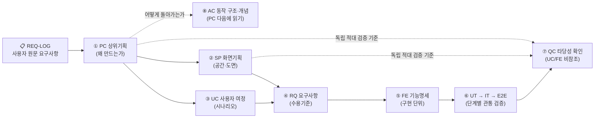

# ① [PC] 상위기획 (Product Concept) — {{PROJECT_NAME}}

> **프로젝트 식별자**: `{{PROJECT_ID}}` · **소유**: `{{OWNER}}` · **책임자(사람)**: `{{RESPONSIBLE_HUMAN}}`  
> **추적표**: 👉 **[📋 사용자 요구사항 원문 기록 & 추적표 열기](docs/specs/00-USER-REQUESTS-traceability.ko.md)**  
> **하위 연결**: **[⑧ 08-AC 동작 구조·개념 설명](docs/specs/08-AC-architecture-concepts.ko.md)** (이 문서 다음에 읽기) · **[② 02-SP 화면기획](docs/specs/02-SP-screen-plan.ko.md)** · **[③ 03-UC 사용자 시나리오](docs/specs/03-UC-user-scenarios.ko.md)** · **[⑦ 07-QC 적대 검증](docs/specs/07-QC-adversarial-review.ko.md)**

---

## 1. 우리가 왜 만드는가 (Vision & Core Identity)

- **`PC-01` (연결: `REQ-LOG-01`) — 제품 존재 이유와 사용자 가치**:
  - `{{PROJECT_NAME}}`: {{PROJECT_DESCRIPTION}}
  - 기획(`PC → SP/UC → RQ → FE`)은 위에서 아래로(Top-down) 명확히 정의하고, 개발은 가장 위험이 큰 핵심 경로의 통합 시험(`IT`)부터 아래에서 위로(Bottom-up) 검증하며 확대합니다.
- **`PC-02` (연결: `REQ-LOG-02`) — 관찰 가능성(D47) 및 책임자 주권 원칙**:
  - 모든 실행 표면은 기본 켜짐(`enabled: true`) 상태의 구조화 디버그 로거(`src/debug-logger.mjs`, 링버퍼 `MAX=200`, `window.__DEBUG__`)를 내장합니다.
  - 본 프로젝트 ADK는 소유(`{{OWNER}}`)와 책임자 사람(`{{RESPONSIBLE_HUMAN}}`)을 명시하며, 비밀 키(`keys/`)는 절대 외부로 심볼릭 링크하거나 동기화하지 않습니다.

---

## 2. 전체 아키텍처 및 명세 흐름도

