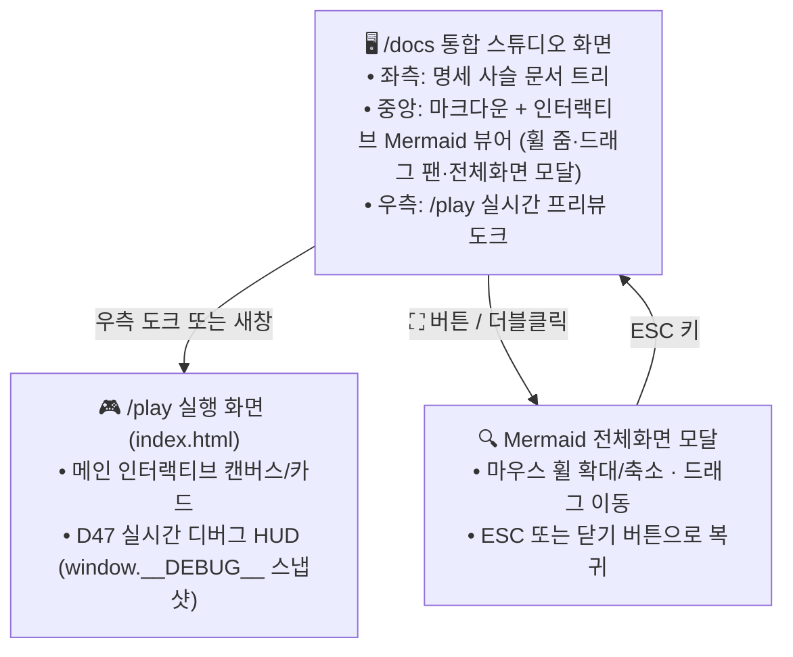

# ② [SP] 화면기획 (Screen Plan) — {{PROJECT_NAME}}

> **상위 문서**: **[📋 요구사항 추적표](docs/specs/00-USER-REQUESTS-traceability.ko.md)** · **[① 01-PC 상위기획](docs/specs/01-PC-product-concept.ko.md)**  
> **하위 연결**: **[③ 03-UC 사용자 시나리오](docs/specs/03-UC-user-scenarios.ko.md)** · **[④ 04-RQ 요구사항](docs/specs/04-RQ-requirements.ko.md)** · **[⑦ 07-QC 적대 검증](docs/specs/07-QC-adversarial-review.ko.md)**

---

## 1. 화면 공간 구성 및 이동 도면

---

## 2. 화면별 상세 도면

- **`SP-01` (연결: `REQ-LOG-01`, `PC-01`) — `/docs` 통합 스튜디오 및 인터랙티브 Mermaid 뷰어**:
  - 좌측 문서 목록에서 `00-USER-REQUESTS-traceability.ko.md` 및 `PC/AC/SP/UC/RQ/FE/UT-IT-E2E/QC` 문서를 즉시 전환합니다.
  - 모든 Mermaid 다이어그램 상단에 `－`, `100%`, `＋`, `폭 맞춤`, `100%`, `⛶` 툴바를 배치하고, 전체화면 모달에서 `Esc`로 닫기를 지원합니다.
- **`SP-02` (연결: `REQ-LOG-02`, `PC-02`) — `/play` 실행 화면 및 디버그 텔레메트리 패널**:
  - 사용자의 액션 이벤트와 에러 상태를 `window.__DEBUG__` 링버퍼(`MAX=200`)에서 실시간으로 조회·내보내기 할 수 있는 패널을 제공합니다.
