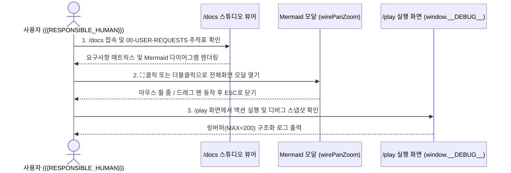

# ③ [UC] 사용자 시나리오 (User Scenarios) — {{PROJECT_NAME}}

> **상위 문서**: **[📋 요구사항 추적표](docs/specs/00-USER-REQUESTS-traceability.ko.md)** · **[① 01-PC 상위기획](docs/specs/01-PC-product-concept.ko.md)** · **[② 02-SP 화면기획](docs/specs/02-SP-screen-plan.ko.md)**  
> **하위 연결**: **[④ 04-RQ 요구사항](docs/specs/04-RQ-requirements.ko.md)** · **[⑥ 06-UT/IT/E2E 검증 계획](docs/specs/06-UT-IT-E2E-test-plan.ko.md)**

---

## 1. 엔드투엔드 사용자 여정 시퀀스

---

## 2. 핵심 시나리오 명세

- **`UC-01` (연결: `REQ-LOG-01`, `PC-01`, `SP-01`) — 요구사항 추적 및 인터랙티브 다이어그램 탐색**:
  1. 사용자가 `/docs`에 접속하면 기본으로 요구사항 추적표 또는 상위기획 문서를 확인한다.
  2. 문서 안의 내부 마크다운 링크를 클릭해 `PC → SP → UC → RQ → FE → QC` 문서를 막힘없이 이동한다.
  3. 다이어그램의 `+`/`-`/`100%`/`⛶` 버튼을 눌러 확대·축소하고 `Esc`로 모달을 닫는다.
- **`UC-02` (연결: `REQ-LOG-02`, `PC-02`, `SP-02`) — 구조화 디버그 로깅 및 무결성 검증**:
  1. 사용자가 `/play` 화면에서 기능을 실행하면 `src/debug-logger.mjs`가 이벤트를 기록한다.
  2. 예기치 않은 런타임 오류(`error`, `unhandledrejection`) 발생 시 글로벌 핸들러가 이를 포착하여 `window.__DEBUG__.exportSnapshot()`에 보존한다.
