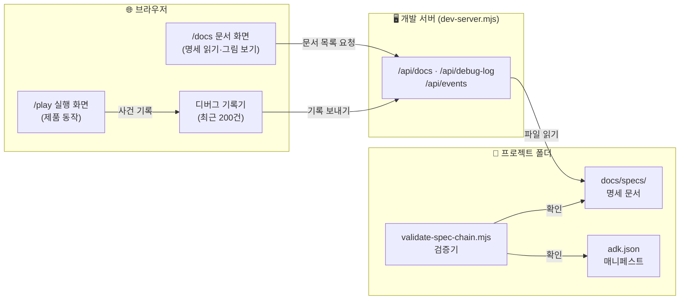
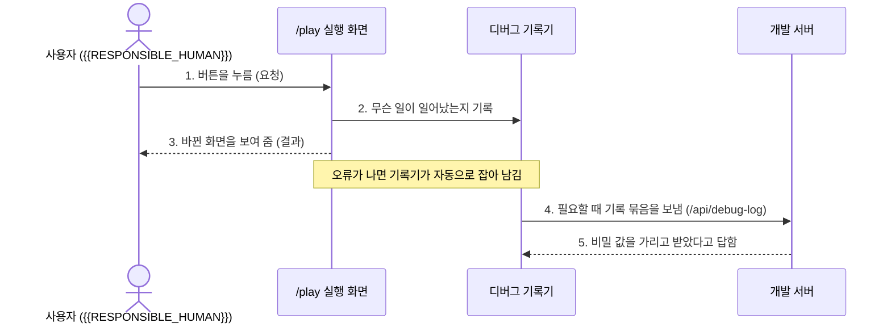

# ⑧ [AC] 동작 구조·개념 설명 (Architecture Concepts) — {{PROJECT_NAME}}

> **읽는 차례**: **[① 01-PC 상위기획](docs/specs/01-PC-product-concept.ko.md)** 을 읽은 뒤 바로 읽습니다. PC 가 "왜 만드는가"를 적는다면, 이 문서는 "어떻게 돌아가는가"를 처음 보는 사람에게 풀어 줍니다.  
> **상위 문서**: **[📋 요구사항 추적표](docs/specs/00-USER-REQUESTS-traceability.ko.md)** · **[① 01-PC 상위기획](docs/specs/01-PC-product-concept.ko.md)**  
> **하위 연결**: **[② 02-SP 화면기획](docs/specs/02-SP-screen-plan.ko.md)** · **[③ 03-UC 사용자 시나리오](docs/specs/03-UC-user-scenarios.ko.md)** · **[⑤ 05-FE 기능명세](docs/specs/05-FE-feature-spec.ko.md)**

> ✏️ **작성 안내**: 아래 보기는 뼈대를 처음 만들 때 들어 있는 구성(문서 화면·실행 화면·디버그 기록기·검증기)을 설명한 것입니다. 제품 구성이 생기면 보기를 지우고 제품 내용으로 바꿉니다. 기술 낱말은 처음 나올 때 한 번 풀어 쓰고, 내부 주소·비밀 값·사람 이름은 적지 않습니다.

---

## 1. 한 문단 요약 — 처음 보는 사람에게

- **`AC-01` (연결: `REQ-LOG-01`, `REQ-LOG-02`, `PC-01`, `PC-02`) — 이 프로젝트를 한 문단으로**:
  - `{{PROJECT_NAME}}`: {{PROJECT_DESCRIPTION}}
  - 이 프로젝트는 기획 문서와 실제로 돌아가는 화면을 서버 하나에서 함께 보여 줍니다. 브라우저로 `/docs` 를 열면 명세 문서와 그림을 읽고, `/play` 를 열면 실행 화면을 씁니다. 실행 화면에서 일어난 일과 오류는 디버그 기록기에 순서대로 남아서, 문제가 생기면 무엇이 어떤 순서로 일어났는지 되짚을 수 있습니다. 문서가 다 있는지, 서로 잘 이어졌는지, 기록기가 약속대로 움직이는지는 검증기가 명령 한 번으로 확인합니다.

> ✏️ **작성 안내**: 다섯 문장 안팎으로, 1분 안에 읽히게 씁니다. 무엇을 하는지, 누가 쓰는지, 무엇이 들어가서 무엇이 나오는지, 꼭 지키는 약속 하나를 담습니다.

---

## 2. 핵심 개념 낱말 풀이

- **`AC-02` (연결: `REQ-LOG-01`, `REQ-LOG-02`) — 이 문서와 회의에서 쓰는 낱말**:

| 낱말 | 뜻 (한 줄) | 어디에 있나 |
|---|---|---|
| 명세 사슬 | 사용자 원문 요구에서 시작해 기획·요구사항·기능·시험·검증까지 항목 번호로 이어 둔 문서 묶음 | `docs/specs/` |
| 추적표 (`REQ-LOG`) | 사용자가 한 말을 원문 그대로 적고, 어느 문서·시험에 반영됐는지 잇는 표 | `00-USER-REQUESTS-traceability.ko.md` |
| 항목 번호 | `PC-01`, `AC-01` 처럼 문서 종류와 번호를 붙인 이름. 다른 문서는 이 번호로 가리킵니다 | 모든 명세 문서 |
| 문서 화면 (`/docs`) | 명세 문서를 읽고, 그림을 확대·이동·전체 화면으로 보는 화면 | `scripts/dev-server.mjs` |
| 실행 화면 (`/play`) | 실제 제품이 돌아가는 화면 | `index.html` |
| 디버그 기록기 | 최근 사건 200건을 순서대로 담는 기록 통. 넘치면 가장 오래된 것부터 밀려납니다 | `src/debug-logger.mjs` |
| 검증기 | 문서·연결·기록기가 약속대로 있는지 명령 한 번으로 확인하는 스크립트 | `scripts/validate-spec-chain.mjs` |
| 매니페스트 | 이 프로젝트의 종류·소유·책임자를 적은 신분증 파일 | `adk.json` |
| 열쇠 폴더 | 비밀 값을 두는 곳. 밖으로 링크하거나 git 에 올리지 않습니다 | `keys/` |

> ✏️ **작성 안내**: 제품 낱말을 더합니다. 사람마다 다르게 부르는 낱말, 줄임말, 다른 회사에 설명할 때 되묻는 낱말은 꼭 넣습니다.

---

## 3. 구성 요소와 맡은 일

- **`AC-03` (연결: `REQ-LOG-01`, `REQ-LOG-02`, `PC-01`) — 무엇이 무엇을 맡는가**:

| 구성 요소 | 맡은 일 | 맡지 않는 일 | 관련 기능 |
|---|---|---|---|
| 개발 서버 (`scripts/dev-server.mjs`) | `/docs`·`/play` 화면과 문서 목록·디버그 기록 받기 창구를 내줍니다 | 제품 규칙 판단, 영구 저장 | `FE-01` |
| 그림 보기 모듈 (`scripts/lib/mermaid-viewer-client.mjs`) | 문서 속 그림을 확대·축소·이동·전체 화면으로 보여 줍니다 | 문서 내용 수정 | `FE-01` |
| 실행 화면 (`index.html`) | 제품 동작을 보여 주고, 일어난 일을 기록기에 넘깁니다 | 기록 보관 | `FE-02` |
| 디버그 기록기 (`src/debug-logger.mjs`) | 사건을 순서대로 담고, 비밀 값을 가리고, 오류를 자동으로 잡습니다 | 화면 그리기 | `FE-02` |
| 검증기 (`scripts/validate-spec-chain.mjs`) | 문서·연결·매니페스트·기록기가 약속대로인지 확인합니다 | 고치기(알려 주기만 함) | `FE-02` |

> ✏️ **작성 안내**: 제품에서 따로 움직이는 덩어리(화면, 서버, 작업 대기열, 데이터베이스, 외부 연결 등)를 한 줄씩 적습니다. "맡지 않는 일" 칸은 책임이 겹치지 않는지 확인하는 칸이니 비우지 않습니다.

---

## 4. 동작 흐름 — 요청이 들어와서 결과가 나가기까지

- **`AC-04` (연결: `REQ-LOG-01`, `REQ-LOG-02`, `PC-02`) — 한 번의 요청이 지나가는 길**:

1. 사용자가 실행 화면에서 무언가를 합니다(요청).
2. 실행 화면이 그 일을 디버그 기록기에 남깁니다.
3. 실행 화면이 결과를 사용자에게 보여 줍니다.
4. 문제를 살펴야 할 때 기록 묶음을 서버로 보냅니다. 서버는 비밀 값과 큰 미디어 자료를 가린 뒤 보관 기간(14일) 안의 것만 남깁니다.

> ✏️ **작성 안내**: 제품에서 가장 자주 일어나는 요청 하나를 골라, 들어오는 곳부터 결과가 나가는 곳까지 순서대로 그립니다. 실패했을 때 어디서 멈추고 무엇이 남는지도 한 줄 적습니다. 화면 배치는 02-SP, 사용자 입장의 이야기는 03-UC 에 두고, 여기서는 구성 요소 사이의 순서만 다룹니다.

---

## 5. 데이터가 어디에 저장되고 누가 읽는가

- **`AC-05` (연결: `REQ-LOG-02`, `PC-02`) — 저장 위치와 읽는 쪽**:

| 데이터 | 저장 위치 | 쓰는 쪽 | 읽는 쪽 | 보관·주의 |
|---|---|---|---|---|
| 명세 문서 | `docs/specs/*.md` (git) | 사람·AI | 문서 화면, 검증기 | git 기록이 곧 변경 이력 |
| 디버그 기록 (화면 쪽) | 브라우저 메모리 (`window.__DEBUG__`) | 디버그 기록기 | 개발자, 실행 화면 기록 패널 | 최근 200건, 새로 고침하면 사라짐 |
| 디버그 기록 (서버 쪽) | 개발 서버 메모리 | 개발 서버 | `/api/debug-log` 를 여는 개발자 | 비밀 값 가림, 14일 지난 것 버림, 서버를 끄면 사라짐 |
| 매니페스트 | `adk.json` (git) | 책임자 | 검증기, 연결 검사 도구 | 소유·책임자 칸은 비워 둘 수 없음 |
| 비밀 값 | `keys/` (git 밖) | 책임자 | 그 값이 필요한 구성 요소만 | 링크·동기화·문서 인용 금지 |

> ✏️ **작성 안내**: 제품이 다루는 데이터마다 한 줄씩 적습니다. 개인정보나 돈과 관련된 데이터는 "보관·주의" 칸에 보관 기간과 지우는 방법을 적습니다.

---

## 6. 바깥과 맞닿는 곳 (연결 서비스)

- **`AC-06` (연결: `REQ-LOG-01`, `REQ-LOG-02`) — 프로젝트 밖과 주고받는 것**:

| 바깥 대상 | 방향 | 주고받는 것 | 안 될 때 | 비밀 값 |
|---|---|---|---|---|
| 공개 스크립트 배포처 (CDN) | 받기 | 문서 화면의 마크다운·그림 그리기 라이브러리 | 문서 화면의 그림이 안 그려짐, 실행 화면은 그대로 | 없음 |
| 브라우저 | 주고받기 | 화면과 기록 | — | 없음 |

> ✏️ **작성 안내**: 로그인, 결제, AI 모델 공급자, 메신저, 저장소 같은 바깥 서비스를 한 줄씩 적습니다. "안 될 때" 칸에는 사용자가 무엇을 겪는지, "비밀 값" 칸에는 값이 아니라 `keys/` 안의 위치 이름만 적습니다.

---

## 7. 이 문서를 언제 고치는가

- **`AC-07` (연결: `REQ-LOG-01`, `REQ-LOG-02`) — 고칠 때와 고친 뒤 할 일**:
  - 구성 요소가 새로 생기거나 없어질 때, 또는 맡은 일이 바뀔 때 (3절)
  - 요청이 지나가는 순서가 바뀔 때 (4절)
  - 데이터 저장 위치·보관 기간·읽는 쪽이 바뀔 때 (5절)
  - 바깥 서비스를 새로 붙이거나 뗄 때 (6절)
  - 다른 사람에게 설명하다가 되묻는 낱말이 나왔을 때 (2절)
  - 고친 뒤에는 **[📋 추적표](docs/specs/00-USER-REQUESTS-traceability.ko.md)** 의 연결 칸을 맞추고 `node scripts/validate-spec-chain.mjs` 를 돌립니다.
